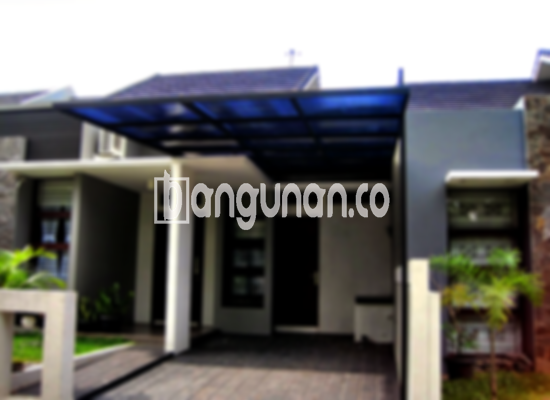

**Jasa Pasang Kanopi Rumah Minimalis di Mojosari** – Pernahkah Anda memikirkan tentang manfaat kanopi untuk rumah Anda? Kanopi merupakan struktur atap yang umumnya diterapkan pada area depan rumah atau jendela, berfungsi untuk melindungi halaman dari paparan sinar matahari langsung maupun hujan. Dengan adanya kanopi, area luar rumah Anda akan lebih nyaman dan terlindungi dari perubahan cuaca. Mitra Bangunan di Mojosari hadir sebagai solusi bagi Anda yang menginginkan kanopi berkualitas dan terpasang dengan rapi.

Terdapat beragam pilihan material kanopi yang dapat Anda pilih, seperti baja ringan dan besi hollo. Pemilihan material yang tepat akan sangat menentukan ketahanan, tampilan, serta biaya dari kanopi tersebut. Kami siap membantu Anda dalam memilih material yang paling sesuai dengan kebutuhan dan anggaran Anda di Mojosari.

Pemasangan kanopi tidak hanya memberikan perlindungan, melainkan juga meningkatkan nilai estetika rumah Anda. Kanopi yang dirancang dengan baik akan menyatu harmonis dengan desain rumah Anda dan menciptakan tampilan yang lebih menarik.



## Harga Kanopi Rumah Minimalis di Mojosari

Jika Anda berencana untuk memasang kanopi di Mojosari, penting untuk memahami perkiraan biayanya terlebih dahulu. Harga kanopi bervariasi, tergantung pada beberapa faktor penting yang perlu Anda pertimbangkan sebelum memesan. Dengan memahami faktor-faktor ini, Anda dapat membuat perencanaan anggaran yang lebih akurat.

Beberapa faktor utama yang memengaruhi harga kanopi antara lain:

### \- Material yang Digunakan oleh Jasa Pasang Kanopi Rumah Minimalis di Mojosari

Jenis material merupakan salah satu faktor utama yang menentukan harga kanopi. Berbagai pilihan material tersedia, termasuk besi, baja ringan, dan lainnya. Setiap material memiliki karakteristik dan harga yang berbeda. Anda dapat memilih material yang paling sesuai dengan preferensi Anda.

### \- Model Kanopi dari Jasa Pasang Kanopi Rumah Minimalis di Mojosari

Desain dan model kanopi juga berpengaruh terhadap harga. Semakin kompleks desainnya, umumnya semakin tinggi biayanya. Pilihlah model yang sesuai dengan gaya arsitektur rumah Anda dan anggaran yang Anda miliki.

### \- Ukuran Kanopi

Ukuran kanopi juga berperan penting dalam menentukan harga. Semakin besar area yang dicakup oleh kanopi, semakin banyak material yang dibutuhkan, dan semakin tinggi pula biayanya. Pastikan untuk melakukan pengukuran yang tepat sebelum memesan kanopi.

Untuk mendapatkan informasi harga yang lebih rinci dan sesuai dengan kebutuhan Anda, Anda bisa melihat tabel harga kami  atau menghubungi tim kami untuk konsultasi gratis.

## Rekomendasi Jenis Kanopi Rumah Minimalis di Mojosari

**Ref by:**  [Kanopi Rumah Minimalis Mojosari](https://id.wikipedia.org/wiki/Kanopi)

Bagi Anda yang ingin memasang kanopi di rumah, terdapat banyak opsi yang bisa dipilih. Salah satu rekomendasi kami adalah kanopi berbahan baja ringan. Material ini menawarkan sejumlah keunggulan dibandingkan material lain. Berikut adalah beberapa keunggulan yang dapat Anda peroleh:

### \- Kekuatan dan Ketahanan sebagai Faktor Utama

Kekuatan adalah aspek penting yang harus dipertimbangkan saat memilih kanopi. Kanopi berbahan baja ringan dikenal memiliki kualitas yang sangat baik dan tahan lama. Material ini mampu menahan berbagai kondisi cuaca ekstrem dan memberikan perlindungan jangka panjang. 

Banyak pengguna telah membuktikan bahwa kanopi baja ringan dapat bertahan hingga bertahun-tahun tanpa mengalami kerusakan yang signifikan.

### \- Beragam Pilihan Desain dari Jasa Pasang Kanopi Rumah Minimalis di Mojosari

Kanopi baja ringan menawarkan fleksibilitas dalam desain. Anda dapat memilih dari berbagai model yang tersedia atau menyesuaikannya dengan gaya arsitektur rumah Anda. Versatilitas ini menjadikannya pilihan populer bagi banyak orang.

### \- Tingkat Keamanan yang Tinggi dari Jasa Pasang Kanopi Rumah Minimalis di Mojosari

Baja ringan memiliki kekuatan tarik yang tinggi, sehingga menawarkan tingkat keamanan yang optimal. Anda dapat merasa tenang karena kanopi Anda akan melindungi Anda dan keluarga dari potensi bahaya. Risiko kerusakan atau roboh sangat minim jika Anda menggunakan kanopi baja ringan berkualitas.

Jika Anda mencari solusi pemasangan kanopi yang kuat, tahan lama, dan estetis di Mojosari, kanopi berbahan baja ringan adalah pilihan yang tepat. Dengan berbagai keunggulannya, Anda akan mendapatkan investasi yang menguntungkan untuk jangka panjang.

Mitra Bangunan siap membantu Anda menemukan solusi kanopi yang ideal untuk rumah Anda di Mojosari. Jangan ragu untuk menghubungi kami melalui tombol WhatsApp atau Telepon yang tertera di halaman ini. Kami akan dengan senang hati memberikan konsultasi dan penawaran terbaik.