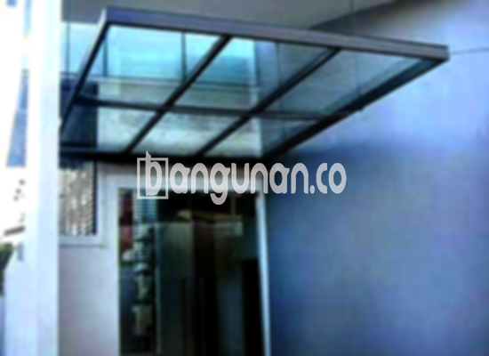

**Jasa Pasang Kanopi Rumah Minimalis di Muaragembong Bekasi** – Mencari solusi perlindungan yang ideal untuk area luar rumah Anda di Muaragembong Bekasi? Kanopi adalah jawaban yang tepat. Sebagai pelindung yang efektif, kanopi tidak hanya melindungi dari cuaca buruk, tetapi juga mempercantik tampilan fasad rumah Anda. Mitra Bangunan hadir untuk memberikan solusi terbaik dalam pembuatan dan pemasangan kanopi berkualitas dan terjangkau.

Kanopi tersedia dalam beragam material, seperti baja ringan dan besi hollo, masing-masing dengan karakteristik unik. Pilihan material akan memengaruhi tampilan, kekuatan, dan tentu saja, harga akhir kanopi. Memilih jenis yang sesuai dengan kebutuhan dan anggaran Anda adalah langkah awal yang penting.

Selain perlindungan dari hujan dan terik matahari, kanopi menawarkan berbagai manfaat penting lainnya bagi rumah Anda. Investasi pada kanopi adalah investasi pada kenyamanan dan keamanan keluarga.



## Pertimbangan Harga Kanopi Rumah Minimalis di Muaragembong Bekasi

Sebelum memutuskan untuk memesan kanopi rumah di Muaragembong Bekasi, penting bagi Anda untuk memahami faktor-faktor yang memengaruhi harga. Pengetahuan ini akan membantu Anda membuat keputusan yang cerdas dan sesuai dengan anggaran yang tersedia. Perencanaan yang matang akan memastikan Anda mendapatkan kanopi yang ideal untuk kebutuhan Anda.

Berikut beberapa faktor utama yang perlu diperhatikan:

### \- Pemilihan Material oleh Jasa Pasang Kanopi Rumah Minimalis di Muaragembong Bekasi

Material adalah salah satu aspek paling krusial dalam menentukan harga kanopi. Pilihan material seperti besi, baja ringan, atau polycarbonate akan memberikan perbedaan signifikan pada biaya. Anda dapat memilih bahan yang paling sesuai dengan estetika dan anggaran Anda.

### \- Desain Kanopi dari Jasa Pasang Kanopi Rumah Minimalis di Muaragembong Bekasi

Model dan desain kanopi juga menjadi faktor penentu harga. Desain yang rumit atau khusus tentu akan membutuhkan biaya lebih tinggi dibandingkan dengan desain yang sederhana. Anda dapat mencari inspirasi desain kanopi di berbagai sumber untuk mendapatkan ide yang sesuai dengan selera Anda.

### \- Ukuran Kanopi

Luas area yang akan ditutupi oleh kanopi secara langsung memengaruhi harga. Semakin besar ukuran kanopi, semakin banyak material dan tenaga kerja yang dibutuhkan, sehingga biaya yang dikeluarkan pun akan semakin tinggi. Pastikan Anda mengukur area dengan tepat sebelum melakukan pemesanan.

Setelah mempertimbangkan faktor-faktor di atas, Anda dapat lebih mudah memperkirakan anggaran yang dibutuhkan untuk proyek kanopi rumah Anda. Untuk informasi harga yang lebih detail, silakan lihat tabel harga di bawah ini atau hubungi tim kami untuk konsultasi gratis. 

## Ragam Kanopi Rumah Minimalis yang Direkomendasikan di Muaragembong Bekasi



Jika Anda sedang mencari kanopi untuk ruko atau bangunan komersial lainnya, kanopi baja ringan adalah pilihan yang sangat direkomendasikan. Material ini menawarkan kombinasi ideal antara kekuatan, daya tahan, dan harga yang terjangkau. Berikut adalah beberapa keunggulan yang bisa Anda dapatkan:

### \- Keawetan Sebagai Prioritas Utama

Salah satu pertimbangan terpenting dalam memilih kanopi adalah keawetannya. Kanopi yang terbuat dari baja ringan dikenal memiliki umur pakai yang panjang dan tahan terhadap berbagai kondisi cuaca ekstrem. Investasi pada kanopi baja ringan adalah investasi jangka panjang yang menguntungkan.

Material ini terbukti mampu bertahan puluhan tahun tanpa kehilangan kekuatannya, memberikan Anda ketenangan pikiran dan mengurangi biaya perawatan jangka panjang.

### \- Pilihan Model yang Beragam dari Jasa Pasang Kanopi Rumah Minimalis di Muaragembong Bekasi

Kanopi baja ringan hadir dalam berbagai model dan desain yang dapat Anda pilih sesuai dengan preferensi Anda. Fleksibilitas ini memungkinkan Anda untuk menciptakan tampilan yang unik dan sesuai dengan gaya arsitektur rumah Anda. 

Anda dapat menemukan berbagai pilihan desain di internet atau berkonsultasi dengan tim kami untuk mendapatkan inspirasi.

### \- Tingkat Keamanan yang Tinggi dari Jasa Pasang Kanopi Rumah Minimalis di Muaragembong Bekasi

Baja ringan adalah material yang sangat kuat dan kokoh, sehingga memberikan tingkat keamanan yang tinggi. Kanopi baja ringan dapat menahan beban angin kencang dan hujan deras tanpa khawatir akan kerusakan. Anda dapat merasa aman dan nyaman dengan kanopi baja ringan yang terpasang dengan benar.

Kanopi baja ringan adalah solusi ideal bagi Anda yang menginginkan perlindungan maksimal, daya tahan tinggi, dan estetika yang menarik untuk rumah Anda di Muaragembong Bekasi.

**Ref by:**  [Kanopi Rumah Minimalis Muaragembong Bekasi](https://id.wikipedia.org/wiki/Kanopi)

Mitra Bangunan siap membantu Anda dalam memilih, merancang, dan memasang kanopi rumah minimalis yang sempurna sesuai dengan kebutuhan Anda di Muaragembong Bekasi. Jangan ragu untuk menghubungi kami melalui tombol WhatsApp atau Telepon pada halaman ini untuk mendapatkan penawaran terbaik dan layanan profesional.