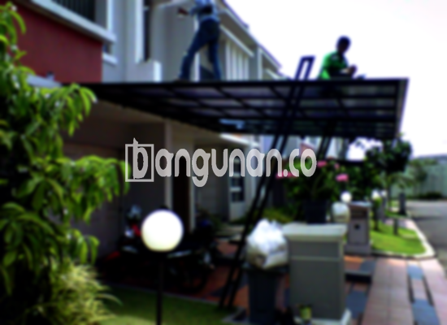

**Jasa Pasang Kanopi Rumah Minimalis di Muarasari Bogor** – Menciptakan area luar rumah yang nyaman dan terlindungi adalah kebutuhan penting bagi setiap keluarga di Muarasari Bogor. Kanopi hadir sebagai solusi praktis untuk menjaga teras, garasi, atau carport Anda dari sengatan matahari dan hujan. Mitra Bangunan memahami betul kebutuhan ini dan siap membantu Anda mewujudkannya dengan layanan pemasangan kanopi berkualitas.

Kanopi bukan hanya berfungsi sebagai pelindung, tetapi juga dapat meningkatkan estetika rumah Anda. Terdapat berbagai jenis material yang dapat dipilih, seperti galvalum dan besi hollo. Masing-masing material memiliki karakteristik dan keunggulannya tersendiri, memungkinkan Anda memilih yang paling sesuai dengan kebutuhan dan preferensi Anda.

Bagi Anda yang memiliki ruko atau bisnis, pemasangan kanopi juga memberikan manfaat signifikan, seperti melindungi area depan dari cuaca ekstrem dan menciptakan kesan yang lebih profesional. Dengan kanopi yang tepat, Anda dapat memaksimalkan fungsi ruang luar dan meningkatkan kenyamanan pelanggan.



## Harga Kanopi Rumah Minimalis di Muarasari Bogor

Apakah Anda sedang mempertimbangkan untuk memasang kanopi di rumah Anda? Sebelum membuat keputusan, penting untuk memahami faktor-faktor yang memengaruhi harga kanopi. Dengan mengetahui hal ini, Anda dapat membuat anggaran yang lebih realistis dan memilih opsi yang paling sesuai dengan kemampuan Anda.

Berikut adalah beberapa faktor utama yang menentukan harga kanopi dari jasa pasang kanopi rumah minimalis di Muarasari Bogor:

### – Material yang Digunakan

Jenis material yang Anda pilih akan sangat memengaruhi biaya pemasangan kanopi. Material populer seperti besi dan baja ringan memiliki rentang harga yang berbeda. Anda bisa memilih material berdasarkan anggaran dan preferensi estetika Anda.

### – Model Kanopi

Model kanopi yang Anda inginkan juga akan memengaruhi harga. Ada berbagai macam model yang tersedia, mulai dari yang sederhana hingga yang lebih kompleks. Model yang lebih rumit biasanya membutuhkan lebih banyak material dan tenaga kerja, sehingga harganya lebih tinggi.

### – Ukuran Kanopi

Ukuran kanopi juga merupakan faktor penting dalam menentukan harga. Semakin besar ukuran kanopi, semakin banyak material yang dibutuhkan, dan semakin tinggi biayanya. Penting untuk mengukur area yang akan ditutupi kanopi dengan akurat sebelum melakukan pemesanan.

Dengan mempertimbangkan faktor-faktor ini, Anda dapat memperkirakan biaya pemasangan kanopi secara lebih akurat. Untuk informasi harga yang lebih detail dan sesuai dengan kebutuhan Anda, silakan lihat tabel harga di bawah ini atau hubungi kami untuk konsultasi gratis.



## Pilihan Tipe Kanopi Rumah Minimalis di Muarasari Bogor

Kami menyediakan berbagai pilihan tipe kanopi rumah minimalis di Muarasari Bogor untuk memenuhi kebutuhan Anda. Salah satu material yang sangat direkomendasikan adalah kanopi berbahan baja ringan. Material ini menawarkan sejumlah keunggulan yang signifikan dibandingkan material lainnya.

### – Keawetan dan Kekokohan

Bagi Anda yang mengutamakan kualitas dan umur panjang, kanopi baja ringan adalah pilihan yang tepat. Material ini dikenal sangat tahan lama dan mampu menahan berbagai kondisi cuaca ekstrem. Anda dapat menikmati manfaatnya selama bertahun-tahun tanpa perlu khawatir tentang perawatan yang rumit.

### – Variasi Model yang Luas

Kanopi baja ringan menawarkan fleksibilitas desain yang tinggi. Anda dapat memilih dari berbagai model yang tersedia, atau bahkan memesan desain khusus sesuai dengan selera Anda. Dengan demikian, Anda dapat menciptakan kanopi yang tidak hanya fungsional, tetapi juga estetis dan serasi dengan gaya rumah Anda.

### – Keamanan yang Terjamin

Baja ringan adalah material yang sangat kokoh dan stabil. Hal ini menjamin keamanan Anda dan keluarga, karena kanopi tidak mudah roboh atau rusak akibat angin kencang atau beban berat. Anda dapat merasa tenang dan nyaman di bawah perlindungan kanopi baja ringan.

Selain baja ringan, kami juga menyediakan kanopi dari material lainnya, seperti galvalum dan polycarbonate. Setiap material memiliki kelebihan dan kekurangannya masing-masing. Tim kami akan dengan senang hati membantu Anda memilih material yang paling sesuai dengan kebutuhan dan anggaran Anda.

**Ref by:**  [Kanopi Rumah Minimalis Muarasari Bogor](https://id.wikipedia.org/wiki/Kanopi)

Bagi Mitra Bangunan yang sedang mencari jasa pasang kanopi di Muarasari Bogor, jangan ragu untuk menghubungi kami melalui tombol WhatsApp atau Telepon yang tersedia di halaman ini. Kami siap memberikan konsultasi gratis, survei lokasi, dan penawaran harga terbaik untuk proyek kanopi Anda. Percayakan kebutuhan kanopi Anda kepada ahlinya! [Jasa Pasang Kanopi Rumah Minimalis di Babakan Bogor](/jasa-pasang-kanopi-rumah-minimalis-di-babakan-bogor/) dapat menjadi referensi tambahan untuk Anda.