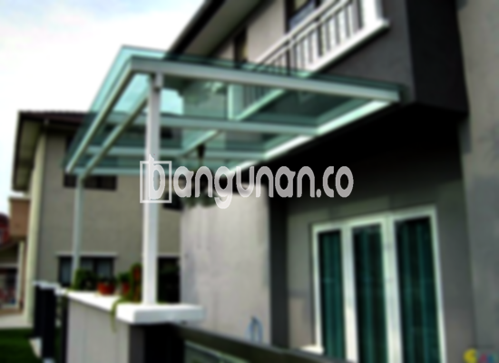

**Jasa Pasang Kanopi Rumah Minimalis di Mulyaharja Bogor** – Apakah Anda sedang mempertimbangkan pemasangan kanopi untuk rumah di Mulyaharja Bogor? Kanopi adalah solusi efektif untuk melindungi teras, garasi, atau area luar rumah lainnya dari sengatan matahari dan guyuran hujan. Sebagai Mitra Bangunan yang bijak, Anda tentu menginginkan perlindungan maksimal dengan tampilan yang estetis. Kami hadir sebagai penyedia jasa borongan pembuatan dan pemasangan kanopi yang terpercaya di Mulyaharja Bogor.

Kanopi tidak hanya berfungsi sebagai pelindung, tetapi juga dapat meningkatkan nilai estetika rumah Anda. Terdapat berbagai pilihan material dan desain yang bisa disesuaikan dengan gaya arsitektur rumah dan preferensi pribadi. Memilih kanopi yang tepat akan memberikan kenyamanan dan kepuasan tersendiri.



## Harga Kanopi Rumah Minimalis di Mulyaharja Bogor

Banyak pertanyaan yang muncul sebelum memesan kanopi, termasuk mengenai perkiraan biaya yang dibutuhkan. Memahami faktor-faktor yang mempengaruhi harga kanopi sangat penting untuk membuat perencanaan anggaran yang tepat. Anda dapat meninjau berbagai opsi dan menyesuaikannya dengan kebutuhan Anda.

Harga kanopi rumah minimalis di Mulyaharja Bogor dapat bervariasi tergantung pada beberapa aspek utama, yaitu:

### \- Jenis Material yang Dipilih

Pemilihan material adalah penentu harga yang signifikan. Kami menyediakan berbagai material berkualitas seperti baja ringan, galvalum, kaca, dan polycarbonate. Setiap material memiliki karakteristik dan harga yang berbeda. Material baja ringan dan galvalum umumnya menjadi pilihan ekonomis, sementara kaca menawarkan tampilan yang mewah dan elegan.

### \- Desain dan Model Kanopi

Desain kanopi juga memengaruhi harga. Semakin kompleks desainnya, tentu akan membutuhkan waktu dan material yang lebih banyak. Anda bisa memilih dari berbagai model kanopi minimalis yang tersedia, atau bahkan mendesain sendiri sesuai dengan keinginan Anda.

### \- Ukuran dan Luas Area Pemasangan

Luas area yang akan ditutupi kanopi secara langsung memengaruhi jumlah material yang dibutuhkan. Semakin luas area pemasangan, semakin banyak material yang digunakan, dan tentu saja akan memengaruhi harga akhir. Pastikan Anda mengukur area pemasangan dengan akurat sebelum melakukan pemesanan.

Untuk informasi lebih detail mengenai harga, Anda dapat melihat tabel harga yang tersedia  atau menghubungi tim kami untuk mendapatkan penawaran khusus yang sesuai dengan kebutuhan Anda.

## Rekomendasi Jenis Kanopi Rumah Minimalis di Mulyaharja Bogor

**Ref by:**  [Kanopi Rumah Minimalis Mulyaharja Bogor](https://id.wikipedia.org/wiki/Kanopi)

Dari berbagai jenis kanopi yang tersedia, kanopi baja ringan menjadi salah satu pilihan paling populer di Mulyaharja Bogor. Material ini menawarkan kombinasi ideal antara kekuatan, harga yang terjangkau, dan kemudahan pemasangan. Berikut adalah beberapa keunggulan kanopi baja ringan yang perlu Anda ketahui:

### \- Kekuatan dan Ketahanan yang Terjamin

Kanopi baja ringan dikenal karena kekuatan dan ketahanannya terhadap berbagai kondisi cuaca. Material ini mampu menahan beban angin kencang dan tidak mudah berkarat, sehingga ideal untuk iklim tropis seperti di Indonesia. Anda dapat mengandalkan kanopi baja ringan untuk memberikan perlindungan jangka panjang bagi rumah Anda.

### \- Variasi Desain yang Luas

Kanopi baja ringan hadir dalam berbagai desain dan model yang dapat disesuaikan dengan gaya arsitektur rumah Anda. Anda dapat memilih dari berbagai bentuk, warna, dan finishing yang menarik. Fleksibilitas desain ini memungkinkan Anda menciptakan tampilan yang unik dan sesuai dengan selera Anda.

### \- Keamanan yang Tinggi

Keamanan merupakan aspek penting dalam memilih kanopi. Baja ringan merupakan material yang kuat dan tahan lama, sehingga meminimalkan risiko kerusakan atau roboh. Pemasangan yang tepat oleh tenaga profesional juga akan semakin meningkatkan keamanan kanopi Anda.

Untuk Anda yang mencari solusi perlindungan yang handal dan terjangkau, kanopi baja ringan adalah pilihan yang tepat. Kami menyediakan layanan pemasangan kanopi baja ringan berkualitas di Mulyaharja Bogor dengan harga yang kompetitif.

Mitra Bangunan yang mencari solusi perlindungan optimal untuk hunian di Mulyaharja Bogor, jangan ragu untuk menghubungi kami melalui tombol WhatsApp atau Telepon yang tertera di halaman ini. Tim kami siap memberikan konsultasi dan penawaran terbaik untuk kebutuhan kanopi Anda. Segera lindungi aset berharga Anda dengan kanopi berkualitas dari penyedia jasa terpercaya!