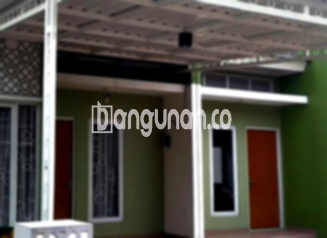

**Jasa Pasang Kanopi Rumah Minimalis di Munjul Jakarta** – Bagi Mitra Bangunan di Munjul Jakarta, kanopi adalah solusi cerdas untuk melindungi properti dari cuaca ekstrem dan mempercantik tampilan rumah. Apakah Anda sedang mempertimbangkan untuk memasang kanopi di teras, garasi, atau area lainnya? Kami hadir sebagai penyedia jasa borongan pembuatan dan pemasangan kanopi yang terpercaya, dengan harga terjangkau dan kualitas terjamin.

Kanopi tidak hanya berfungsi sebagai pelindung dari panas matahari dan hujan deras, tetapi juga menambah nilai estetika bangunan Anda. Tersedia berbagai pilihan material kanopi, seperti baja ringan, besi hollo, kaca, dan polycarbonate, masing-masing dengan kelebihan dan kekurangannya. Penyesuaian material ini memungkinkan Anda mendapatkan kanopi yang tidak hanya fungsional, tetapi juga selaras dengan gaya arsitektur rumah Anda.

Memiliki kanopi yang tepat menawarkan beragam manfaat bagi tempat tinggal Anda. Selain melindungi dari cuaca, kanopi juga dapat menciptakan ruang luar yang nyaman untuk bersantai dan menerima tamu. Dengan desain minimalis yang sedang populer, kanopi dapat menjadi elemen dekoratif yang memperindah fasad rumah Anda.



## Estimasi Biaya Kanopi Rumah Minimalis di Munjul Jakarta

Apakah Anda ingin mengetahui perkiraan biaya pemasangan kanopi untuk rumah di Munjul Jakarta? Sebelum memutuskan, penting untuk memahami faktor-faktor yang memengaruhi harga kanopi agar Anda dapat merencanakan anggaran dengan lebih baik. Dengan memahami variabel ini, Anda dapat memilih kanopi yang sesuai dengan kebutuhan dan anggaran Anda.

Beberapa faktor utama yang memengaruhi harga kanopi adalah:

### - Jenis Material yang Dipilih

Pemilihan material kanopi memiliki dampak signifikan terhadap harga. Bahan seperti besi, baja ringan, dan polycarbonate memiliki harga yang berbeda-beda. Anda dapat memilih material yang paling sesuai dengan preferensi dan anggaran Anda. Pertimbangkan juga kelebihan dan kekurangan masing-masing material sebelum membuat keputusan.

### - Desain dan Model Kanopi

Desain kanopi juga memengaruhi biaya. Model yang lebih kompleks atau membutuhkan banyak detail akan cenderung lebih mahal daripada desain yang sederhana. Anda dapat berkonsultasi dengan tim kami untuk mendapatkan desain yang sesuai dengan gaya rumah dan anggaran Anda. Kami siap membantu Anda memilih model yang tepat dan menarik.

### - Luas Area yang Ditutupi

Luas area yang akan ditutupi oleh kanopi juga menjadi faktor penentu harga. Semakin luas area yang ditutupi, semakin banyak material yang dibutuhkan, sehingga biaya yang dikeluarkan juga akan meningkat. Pastikan Anda mengukur area yang akan ditutupi dengan akurat agar mendapatkan estimasi biaya yang tepat.

Untuk informasi harga yang lebih detail, Anda dapat melihat tabel harga yang tersedia . Kami juga siap memberikan penawaran harga khusus yang disesuaikan dengan kebutuhan Anda.

## Pilihan Jenis Kanopi Rumah Minimalis di Munjul Jakarta

**Ref by:**  [Kanopi Rumah Minimalis Munjul Jakarta](https://id.wikipedia.org/wiki/Kanopi)

Kami menawarkan berbagai pilihan jenis kanopi yang dapat Anda pilih, mulai dari yang sederhana hingga yang lebih mewah. Salah satu pilihan yang paling populer adalah kanopi berbahan baja ringan. Material ini memiliki banyak keunggulan dibandingkan material lain. Berikut adalah beberapa keistimewaannya:

### - Kekuatan dan Ketahanan Tinggi

Kekuatan adalah faktor penting yang perlu Anda perhatikan saat memilih kanopi. Kanopi berbahan baja ringan dikenal memiliki kekuatan dan ketahanan yang sangat baik. Material ini mampu menahan beban berat dan tahan terhadap cuaca ekstrem. Investasi pada kanopi baja ringan akan memberikan ketenangan pikiran karena Anda tidak perlu khawatir tentang kerusakan akibat cuaca buruk.

### - Variasi Desain yang Luas

Bagi Anda yang menginginkan desain kanopi yang unik dan menarik, baja ringan menawarkan fleksibilitas desain yang tinggi. Material ini mudah dibentuk dan dapat disesuaikan dengan berbagai gaya arsitektur. Anda dapat memilih dari berbagai model yang tersedia atau mendesain sendiri sesuai dengan keinginan Anda.

### - Keamanan yang Terjamin

Keamanan adalah prioritas utama kami. Kanopi berbahan baja ringan memiliki tingkat keamanan yang tinggi karena material ini tahan terhadap karat dan korosi. Anda dapat menggunakan kanopi ini dengan tenang tanpa khawatir tentang risiko kecelakaan. Pastikan Anda memilih penyedia jasa yang terpercaya dan berpengalaman untuk memastikan pemasangan yang aman dan berkualitas.

Dengan berbagai pilihan jenis kanopi yang kami tawarkan, Anda dapat menemukan solusi yang tepat untuk melindungi dan mempercantik rumah Anda di Munjul Jakarta. Jangan ragu untuk menghubungi kami untuk konsultasi gratis dan mendapatkan penawaran terbaik.

[[[PLACEHOLDER_N]]]

Bagi Mitra Bangunan yang sedang mencari jasa pasang kanopi di Munjul Jakarta, hubungi kami melalui tombol WhatsApp atau Telepon di halaman ini, dan kami siap membantu Anda.