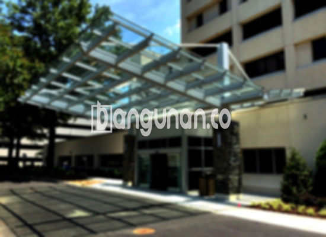

**Jasa Pasang Kanopi Rumah Minimalis di Muntilan** – Apakah Anda sedang merencanakan perlindungan optimal untuk teras atau garasi rumah Anda di Muntilan? Kanopi adalah solusi tepat yang tidak hanya melindungi dari cuaca ekstrem, tetapi juga meningkatkan estetika bangunan Anda. Bagi Mitra Bangunan di Muntilan, kami hadir sebagai penyedia jasa pembuatan dan pemasangan kanopi berkualitas dengan harga terjangkau.

Kanopi hadir dalam beragam material, seperti baja ringan dan besi hollo. Anda dapat memilih jenis kanopi yang paling sesuai dengan kebutuhan dan preferensi desain. Setiap material memiliki kelebihan dan kekurangannya masing-masing, memungkinkan Anda menemukan solusi yang ideal untuk rumah Anda.

Memasang kanopi tidak hanya memberikan perlindungan dari panas dan hujan, tetapi juga menawarkan sejumlah manfaat penting lainnya bagi hunian Anda. 



## Harga Kanopi Rumah Minimalis di Muntilan

Tertarik untuk memasang kanopi untuk rumah Anda? Sebelum membuat keputusan, penting untuk memahami perkiraan harga kanopi terlebih dahulu. Dengan memahami kisaran harga, Anda dapat membuat perencanaan anggaran yang lebih efektif dan memilih kanopi yang paling sesuai dengan kemampuan finansial Anda.

Harga kanopi dipengaruhi oleh beberapa faktor utama, antara lain:

### - Bahan yang Digunakan oleh Jasa Pasang Kanopi Rumah Minimalis di Muntilan

Pemilihan bahan merupakan pertimbangan penting dalam memilih kanopi. Terdapat berbagai pilihan material yang tersedia, seperti besi dan baja ringan. Setiap bahan memiliki karakteristik dan harga yang berbeda-beda. Anda dapat memilih material yang sesuai dengan kebutuhan dan anggaran Anda.

### - Model Kanopi dari Jasa Pasang Kanopi Rumah Minimalis di Muntilan

Model kanopi juga berperan dalam menentukan harga. Terdapat berbagai pilihan desain dan model kanopi yang dapat Anda pilih. Semakin kompleks desainnya, umumnya semakin tinggi pula harganya. Anda dapat menjelajahi berbagai referensi model kanopi untuk menemukan yang paling sesuai dengan gaya arsitektur rumah Anda.

### - Ukuran Kanopi (Panjang dan Lebar)

Ukuran kanopi, baik panjang maupun lebarnya, juga memengaruhi harga. Semakin besar ukuran kanopi yang Anda butuhkan, semakin banyak material yang digunakan, sehingga harganya pun akan lebih tinggi. Pastikan Anda mengukur area yang akan ditutupi kanopi dengan akurat sebelum memesan.

Setelah mempertimbangkan faktor-faktor di atas, Anda akan dapat memperkirakan biaya yang dibutuhkan. Semakin baik kualitas material dan desain yang Anda pilih, semakin tinggi pula investasinya.

## Rekomendasi Tipe Kanopi Rumah Minimalis di Muntilan



Bagi Anda yang ingin memasang kanopi untuk bangunan komersial seperti ruko, ada banyak pilihan model kanopi yang bisa Anda pertimbangkan. Salah satu pilihan terbaik adalah kanopi berbahan baja ringan. Material ini menawarkan sejumlah keunggulan dibandingkan material lainnya. Berikut beberapa keunggulan utama yang dapat Anda peroleh:

### - Kekuatan dan Ketahanan yang Unggul

Kekuatan merupakan faktor penting yang perlu diperhatikan saat memilih kanopi. Kanopi berbahan galvalum dikenal memiliki kualitas yang sangat baik dan tahan lama. Anda dapat yakin bahwa kanopi ini akan memberikan perlindungan yang maksimal selama bertahun-tahun.

Banyak pengguna telah membuktikan kekuatan kanopi baja ringan. Dengan perawatan yang tepat, kanopi jenis ini dapat bertahan selama puluhan tahun tanpa kehilangan kekuatannya.

### - Desain dan Model yang Bervariasi dari Jasa Pasang Kanopi Rumah Minimalis di Muntilan

Jika Anda menginginkan kanopi dengan tampilan yang menarik, baja ringan menawarkan fleksibilitas desain yang tinggi. Terdapat berbagai macam model dan desain kanopi baja ringan yang dapat Anda pilih, sehingga Anda dapat menemukan yang paling sesuai dengan gaya arsitektur rumah Anda. Keunggulan ini menjadikan kanopi baja ringan semakin populer di kalangan pemilik rumah.

### - Keamanan yang Terjamin dari Jasa Pasang Kanopi Rumah Minimalis di Muntilan

Baja ringan adalah material yang memiliki tingkat kekokohan yang tinggi, sehingga keamanannya sangat terjamin. Anda dapat merasa aman dan nyaman dengan kanopi baja ringan, karena risiko kerusakan atau roboh sangat kecil.

Bagi Anda yang sedang mencari kanopi untuk rumah di Muntilan, kanopi berbahan galvalum merupakan pilihan yang tepat. Banyak keunggulan yang dapat Anda peroleh dengan menggunakan jenis kanopi ini. Anda dapat memilih berbagai material seperti kaca, polycarbonate, atau galvalum untuk mewujudkan desain yang Anda inginkan di Muntilan.

Semoga informasi ini bermanfaat bagi Anda. Mitra Bangunan yang ingin memesan kanopi dengan kualitas terbaik untuk rumah di Muntilan, jangan ragu untuk menghubungi kami melalui tombol WhatsApp atau Telepon yang tersedia di halaman ini. Kami siap memberikan penawaran terbaik dan layanan pemasangan profesional.

**Ref by:**  [Kanopi Rumah Minimalis Muntilan](https://id.wikipedia.org/wiki/Kanopi)