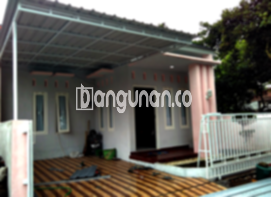

**Jasa Pasang Kanopi Rumah Minimalis di Mustika Jaya Bekasi** – Memiliki area luar rumah yang nyaman dan terlindungi adalah impian setiap pemilik hunian di Mustika Jaya Bekasi. Kanopi hadir sebagai solusi praktis untuk menciptakan ruang terbuka yang fungsional, baik sebagai pelindung teras, carport, atau area santai. Kami hadir sebagai penyedia jasa pemasangan kanopi yang berkualitas dan terjangkau, membantu Mitra Bangunan mewujudkan kenyamanan tersebut.

Kanopi hadir dalam beragam material, memungkinkan Anda menyesuaikan pilihan dengan gaya arsitektur rumah dan anggaran yang tersedia. Beberapa material populer meliputi baja ringan, besi hollo, kaca, dan polycarbonate, masing-masing menawarkan keunggulan tersendiri.



## Investasi pada Kenyamanan: Harga Kanopi Rumah Minimalis di Mustika Jaya Bekasi

Sebelum memutuskan untuk memasang kanopi, wajar jika Anda mempertimbangkan aspek biaya. Memahami faktor-faktor yang memengaruhi harga kanopi rumah minimalis di Mustika Jaya Bekasi akan membantu Anda membuat keputusan yang tepat. Untuk informasi harga detail, silakan merujuk pada tabel harga yang tersedia .

Beberapa faktor utama yang memengaruhi harga kanopi antara lain:

### \- Pemilihan Material yang Tepat

Material konstruksi memainkan peran penting dalam menentukan harga kanopi. Pilihan seperti besi, baja ringan, atau polycarbonate memiliki rentang harga yang berbeda. Anda dapat memilih material yang paling sesuai dengan anggaran dan preferensi estetika Anda.

### \- Desain dan Model Kanopi yang Dipilih

Model kanopi yang Anda pilih juga memengaruhi biaya keseluruhan. Desain yang rumit dengan detail khusus umumnya memerlukan biaya yang lebih tinggi dibandingkan dengan model sederhana dan minimalis. 

### \- Ukuran dan Luas Area yang Dicakup

Ukuran kanopi yang akan dipasang secara langsung memengaruhi jumlah material yang dibutuhkan dan kompleksitas pekerjaan. Semakin luas area yang perlu dicakup, semakin tinggi pula biaya yang dibutuhkan.

**Ref by:**  [Kanopi Rumah Minimalis Mustika Jaya Bekasi](https://id.wikipedia.org/wiki/Kanopi)

## Ragam Pilihan Kanopi Rumah Minimalis untuk Hunian Anda di Mustika Jaya Bekasi

Untuk mempercantik dan melindungi rumah Anda di Mustika Jaya Bekasi, ada berbagai jenis kanopi yang dapat dipilih. Kami menawarkan beragam solusi kanopi yang sesuai dengan kebutuhan dan gaya Anda. Beberapa opsi populer meliputi:

### \- Kanopi Baja Ringan: Kuat, Ringan, dan Tahan Lama

Kanopi baja ringan menjadi pilihan populer karena kekuatannya, bobotnya yang ringan, dan daya tahannya terhadap cuaca ekstrem. Material ini ideal untuk berbagai aplikasi, mulai dari carport hingga teras rumah. Anda akan mendapatkan ketahanan dan keamanan yang terjamin.

### \- Kanopi Kaca: Sentuhan Modern dan Elegan

Jika Anda menginginkan tampilan yang modern dan elegan, kanopi kaca adalah pilihan yang tepat. Kanopi kaca memberikan kesan lapang dan memungkinkan cahaya alami masuk, menciptakan suasana yang cerah dan nyaman.

### \- Kanopi Polycarbonate: Kombinasi Kekuatan dan Estetika

Kanopi polycarbonate menawarkan kombinasi ideal antara kekuatan dan estetika. Material ini tahan benturan, ringan, dan tersedia dalam berbagai pilihan warna dan ketebalan. Kanopi polycarbonate cocok untuk berbagai aplikasi, termasuk teras, balkon, dan area bermain anak.

Dengan berbagai pilihan material dan desain yang tersedia, Anda dapat menemukan kanopi yang sempurna untuk meningkatkan kenyamanan dan estetika rumah Anda di Mustika Jaya Bekasi. Anda dapat membahas preferensi Anda dengan tim kami untuk mendapatkan rekomendasi yang sesuai dengan kebutuhan dan anggaran Anda. Bagi Anda di Mustika Jaya Bekasi, kami siap membantu dalam mewujudkan kanopi impian Anda.

Mitra Bangunan yang sedang mencari jasa pasang kanopi berkualitas di Mustika Jaya Bekasi, jangan ragu untuk menghubungi kami melalui tombol WhatsApp atau Telepon yang tersedia di halaman ini. Kami siap memberikan konsultasi gratis dan penawaran terbaik sesuai dengan kebutuhan Anda.