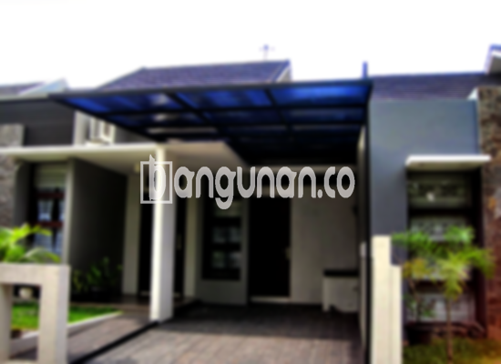

**Jasa Pasang Kanopi Rumah Minimalis di Neglasari Tangerang** – Membangun kenyamanan dan estetika rumah di Neglasari Tangerang seringkali dimulai dari area luar. Apakah Anda sedang mempertimbangkan pelindung yang efektif untuk teras, carport, atau area komersial? Kanopi adalah solusi tepat untuk melindungi properti Anda dari cuaca ekstrem. Mitra Bangunan hadir sebagai penyedia jasa pembuatan dan pemasangan kanopi berkualitas dan terjangkau, dirancang khusus untuk kebutuhan Anda.

Kanopi hadir dalam berbagai material, termasuk galvalum dan besi hollo, memungkinkan Anda memilih yang paling sesuai dengan gaya dan anggaran Anda. Setiap material memiliki keunggulan dan kekurangan unik, yang akan kami bantu Anda pertimbangkan.

Manfaat pemasangan kanopi melampaui sekadar perlindungan. Kanopi dapat meningkatkan nilai estetika rumah, menciptakan ruang luar yang lebih fungsional, dan memberikan perlindungan optimal dari panas dan hujan.



## Harga Kanopi Rumah Minimalis di Neglasari Tangerang

Apakah Anda ingin mempercantik rumah dengan kanopi yang elegan dan fungsional? Sebelum membuat keputusan, penting untuk memahami perkiraan biaya yang terlibat. Dengan mengetahui rentang harga, Anda dapat merencanakan anggaran dengan lebih efektif dan memilih opsi yang paling sesuai dengan kebutuhan Anda. 

Harga kanopi dipengaruhi oleh beberapa faktor penting, antara lain:

### – Material yang Digunakan Oleh Jasa Pasang Kanopi Rumah Minimalis di Neglasari Tangerang

Pilihan material merupakan pertimbangan utama dalam menentukan harga kanopi. Berbagai jenis bahan, seperti besi, baja ringan, dan polycarbonate, memiliki karakteristik dan harga yang berbeda-beda. Anda dapat memilih material yang paling sesuai dengan preferensi estetika, anggaran, dan kebutuhan fungsional Anda.

### – Model Kanopi dari Jasa Pasang Kanopi Rumah Minimalis di Neglasari Tangerang

Model kanopi yang Anda pilih juga akan memengaruhi biayanya. Terdapat berbagai pilihan desain, mulai dari yang sederhana hingga yang lebih kompleks. Model yang lebih rumit atau dengan detail khusus biasanya akan lebih mahal daripada model standar.

### – Ukuran Kanopi

Ukuran kanopi secara langsung berkorelasi dengan biaya. Kanopi yang lebih besar membutuhkan lebih banyak material dan tenaga kerja, sehingga harganya akan lebih tinggi. Sebelum memesan, pastikan Anda melakukan pengukuran yang akurat untuk menentukan ukuran yang tepat.

Untuk informasi harga yang lebih detail dan sesuai dengan kebutuhan spesifik Anda, kami sarankan untuk menghubungi tim kami. Kami akan dengan senang hati memberikan penawaran yang personal dan transparan.

## Rekomendasi Macam Kanopi Rumah Minimalis di Neglasari Tangerang



Bagi Anda yang berencana memasang kanopi untuk rumah di Neglasari Tangerang, terdapat beragam pilihan yang dapat Anda pertimbangkan. Salah satu pilihan populer adalah kanopi berbahan baja ringan. Material ini menawarkan kombinasi yang menarik antara kekuatan, daya tahan, dan harga yang terjangkau. 

### – Kekuatan dan Ketahanan Sebagai Prioritas Utama

Saat memilih kanopi, kekuatan dan ketahanan adalah faktor yang sangat penting. Kanopi berbahan baja ringan dirancang untuk tahan terhadap kondisi cuaca ekstrem, seperti angin kencang dan hujan lebat. Material ini juga memiliki ketahanan yang baik terhadap karat dan korosi, sehingga dapat bertahan lama tanpa perawatan yang intensif.

Banyak pelanggan kami di Neglasari Tangerang yang telah membuktikan sendiri keawetan kanopi baja ringan. Dengan perawatan yang tepat, kanopi ini dapat melindungi properti Anda selama bertahun-tahun.

### – Variasi Desain yang Luas dari Jasa Pasang Kanopi Rumah Minimalis di Neglasari Tangerang

Selain kekuatannya, kanopi baja ringan juga menawarkan fleksibilitas desain yang tinggi. Anda dapat memilih dari berbagai macam bentuk, ukuran, dan warna untuk menciptakan tampilan yang sesuai dengan gaya arsitektur rumah Anda. Kami menawarkan berbagai opsi desain yang dapat disesuaikan dengan preferensi pribadi Anda.

### – Keamanan yang Terjamin dari Jasa Pasang Kanopi Rumah Minimalis di Neglasari Tangerang

Keamanan merupakan aspek penting dalam memilih kanopi. Baja ringan adalah material yang kokoh dan stabil, sehingga dapat memberikan perlindungan yang andal terhadap elemen-elemen alam. Dengan kanopi baja ringan, Anda dapat merasa tenang dan nyaman di bawahnya, bahkan saat cuaca buruk.

Dengan mempertimbangkan berbagai keunggulan yang ditawarkan, kanopi baja ringan merupakan pilihan yang sangat baik untuk Anda yang mencari solusi perlindungan yang efektif, tahan lama, dan estetis.

**Ref by:**  [Kanopi Rumah Minimalis Neglasari Tangerang](https://id.wikipedia.org/wiki/Kanopi)

Mitra Bangunan siap membantu Anda mewujudkan hunian impian dengan kanopi berkualitas di Neglasari Tangerang. Jangan ragu untuk menghubungi kami melalui tombol WhatsApp atau Telepon yang tersedia di halaman ini untuk konsultasi gratis dan penawaran terbaik.