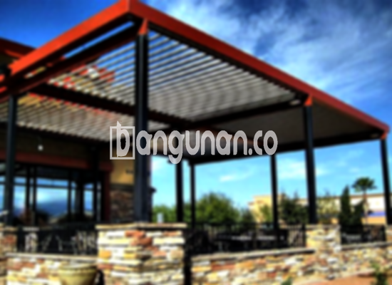

**Jasa Pasang Kanopi Rumah Minimalis di Ngamprah** – Mempertimbangkan perlindungan optimal untuk teras atau garasi rumah Anda di Ngamprah? Kanopi adalah solusi tepat yang tidak hanya melindungi dari cuaca ekstrem, tetapi juga mempercantik tampilan fasad rumah. Mitra Bangunan di Ngamprah tidak perlu repot mencari tukang yang tepat – kami hadir untuk memberikan layanan pembuatan dan pemasangan kanopi berkualitas dengan harga terjangkau.

Kanopi hadir dalam beragam material, mulai dari galvalum yang ringan dan ekonomis, hingga besi hollo yang kuat dan tahan lama. Pilihan material ini memungkinkan Anda menyesuaikan kanopi dengan kebutuhan dan anggaran yang tersedia. Setiap jenis kanopi memiliki keunggulan tersendiri yang menjadikannya solusi ideal untuk berbagai aplikasi.

Bagi Anda yang berencana memasang kanopi untuk rumah, terdapat beragam manfaat yang bisa dirasakan. Perlindungan dari paparan sinar matahari dan hujan adalah manfaat utama, namun kanopi juga dapat meningkatkan nilai estetika rumah dan menciptakan ruang outdoor yang lebih nyaman.



## Harga Kanopi Rumah Minimalis di Ngamprah

Apakah Anda sedang merencanakan pemasangan kanopi untuk rumah Anda di Ngamprah? Sebelum membuat keputusan, penting untuk memahami perkiraan biaya yang dibutuhkan. Dengan memahami kisaran harga, Anda dapat merencanakan anggaran dengan lebih baik dan memilih opsi yang sesuai dengan kebutuhan Anda. Untuk informasi harga yang lebih detail dan terkini, silakan lihat tabel harga yang tersedia atau hubungi tim kami. Kami akan bantu menghitung estimasi biaya berdasarkan kebutuhan spesifik Anda. 

Harga kanopi dipengaruhi oleh beberapa faktor penting, termasuk:

### – Material yang Digunakan

Pemilihan material merupakan langkah penting dalam memilih kanopi. Berbagai material seperti besi, baja ringan, dan polycarbonate memiliki karakteristik dan harga yang berbeda. Anda dapat memilih material yang paling sesuai dengan preferensi estetika, anggaran, dan kebutuhan fungsional Anda.

### – Model dan Desain Kanopi

Model dan desain kanopi juga memengaruhi harga. Anda dapat memilih dari berbagai pilihan desain, mulai dari yang sederhana hingga yang lebih kompleks. Semakin rumit desainnya, umumnya biaya pemasangannya akan lebih tinggi.

### – Ukuran Kanopi

Ukuran kanopi, baik panjang maupun lebar, akan secara langsung memengaruhi total biaya. Semakin luas area yang ingin ditutupi, semakin banyak material yang dibutuhkan, dan akibatnya, semakin tinggi pula biayanya. Pastikan Anda mengukur area yang ingin ditutupi dengan akurat sebelum memesan kanopi.



Dengan mempertimbangkan faktor-faktor ini, Anda akan lebih siap untuk memilih kanopi yang tepat dan sesuai dengan anggaran Anda.

## Rekomendasi Jenis Kanopi Rumah Minimalis di Ngamprah

Untuk Anda yang sedang mempertimbangkan pemasangan kanopi di Ngamprah, kanopi berbahan baja ringan merupakan pilihan yang sangat direkomendasikan. Material ini menawarkan sejumlah keunggulan yang membuatnya menjadi solusi ideal untuk melindungi teras, garasi, atau area luar ruangan lainnya. Berikut beberapa keunggulan yang dapat Anda peroleh:

### – Kekuatan dan Daya Tahan

Salah satu pertimbangan utama saat memilih kanopi adalah kekuatannya. Kanopi yang terbuat dari baja ringan memiliki kualitas yang sangat baik dan mampu menahan beban yang signifikan. Dengan demikian, Anda dapat yakin bahwa kanopi akan memberikan perlindungan yang andal selama bertahun-tahun.

### – Variasi Desain yang Luas

Selain kekuatannya, kanopi baja ringan juga menawarkan variasi desain yang luas. Anda dapat memilih dari berbagai model dan gaya yang sesuai dengan arsitektur rumah Anda. Fleksibilitas ini memungkinkan Anda menciptakan tampilan yang harmonis dan estetis.

### – Keamanan yang Terjamin

Baja ringan merupakan material yang sangat aman dan tahan terhadap risiko karat dan korosi. Hal ini memastikan bahwa kanopi akan tetap kuat dan terjaga keamanannya dalam jangka waktu yang lama. Anda dapat menikmati ketenangan pikiran dengan mengetahui bahwa kanopi Anda akan melindungi Anda dan keluarga dari berbagai elemen cuaca.

Bagi Anda yang membutuhkan kanopi untuk bisnis, seperti ruko atau toko, kanopi berbahan baja ringan juga merupakan pilihan yang tepat. Keunggulannya dalam hal kekuatan, daya tahan, dan keamanan menjadikannya investasi yang bijaksana.

Dengan mempertimbangkan semua manfaat tersebut, Anda dapat yakin bahwa kanopi baja ringan adalah solusi yang tepat untuk kebutuhan perlindungan dan estetika rumah Anda di Ngamprah. 

**Ref by:**  [Kanopi Rumah Minimalis Ngamprah](https://id.wikipedia.org/wiki/Kanopi)

Mitra Bangunan siap membantu Anda dalam memilih dan memasang kanopi rumah minimalis yang sesuai dengan kebutuhan dan anggaran Anda di Ngamprah. Jangan ragu untuk menghubungi kami melalui tombol WhatsApp atau Telepon yang tersedia di halaman ini untuk konsultasi gratis dan penawaran terbaik. Kami berkomitmen untuk memberikan pelayanan yang profesional dan hasil yang memuaskan.