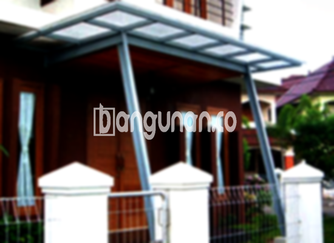

**Jasa Pasang Kanopi Rumah Minimalis di Nganjuk** – Mencari solusi ideal untuk melindungi teras atau garasi rumah Anda di Nganjuk? Kanopi dapat menjadi jawaban tepat, memberikan perlindungan optimal dari cuaca ekstrem sekaligus mempercantik tampilan rumah. Mitra Bangunan siap membantu Anda mewujudkan kanopi impian dengan layanan yang berkualitas dan terjangkau.

Kanopi hadir dalam beragam material, seperti galvalum dan besi hollo. Anda dapat memilih jenis kanopi yang paling sesuai dengan kebutuhan dan preferensi estetika Anda. Setiap material menawarkan kelebihan dan kekurangan yang perlu dipertimbangkan sebelum membuat keputusan.

Investasi dalam kanopi memberikan banyak manfaat bagi rumah Anda. Selain melindungi dari paparan sinar matahari dan hujan, kanopi juga dapat meningkatkan nilai properti dan menciptakan ruang outdoor yang lebih nyaman.



## Harga Kanopi Rumah Minimalis di Nganjuk

Sebelum memilih kanopi untuk rumah Anda, penting untuk memahami perkiraan biayanya. Dengan mengetahui kisaran harga, Anda dapat membuat perencanaan anggaran yang lebih baik dan memilih opsi yang paling sesuai dengan kemampuan finansial Anda. Anda bisa membandingkan berbagai penawaran sehingga mendapatkan kanopi yang Anda inginkan.

Berikut adalah beberapa faktor utama yang memengaruhi harga kanopi:

### – Material yang Digunakan oleh Jasa Pasang Kanopi Rumah Minimalis di Nganjuk

Jenis material merupakan salah satu faktor penentu harga yang paling signifikan. Material seperti besi, baja ringan, dan polycarbonate memiliki harga yang berbeda-beda. Anda dapat menyesuaikan pilihan material dengan anggaran dan kebutuhan Anda.

### – Model Kanopi dari Jasa Pasang Kanopi Rumah Minimalis di Nganjuk

Desain dan model kanopi juga memengaruhi harga akhir. Pilihan desain yang lebih kompleks atau rumit biasanya akan membutuhkan biaya yang lebih tinggi. Ada banyak sekali model kanopi minimalis yang bisa Anda temukan sebagai inspirasi.

### – Ukuran Kanopi

Ukuran kanopi tentu saja memengaruhi besarnya biaya yang harus Anda keluarkan. Semakin luas area yang akan ditutupi oleh kanopi, semakin banyak material yang dibutuhkan dan semakin tinggi pula biayanya. Penting untuk melakukan pengukuran yang akurat sebelum memesan kanopi.

Dengan mempertimbangkan faktor-faktor di atas, Anda dapat memperkirakan biaya yang dibutuhkan untuk memasang kanopi di rumah Anda. Untuk informasi harga yang lebih detail dan akurat, silakan lihat tabel harga di  atau hubungi tim kami untuk konsultasi gratis.

## Rekomendasi Variasi Kanopi Rumah Minimalis di Nganjuk

**Ref by:**  [Kanopi Rumah Minimalis Nganjuk](https://id.wikipedia.org/wiki/Kanopi)

Bagi Anda yang membutuhkan kanopi untuk berbagai jenis bangunan, terdapat banyak pilihan yang tersedia. Salah satu material yang sangat direkomendasikan adalah baja ringan. Kanopi baja ringan menawarkan sejumlah keunggulan dibandingkan material lain.

### – Kekuatan dan Ketahanan Tinggi

Salah satu pertimbangan utama saat memilih kanopi adalah kekuatannya. Kanopi yang terbuat dari baja ringan dikenal sangat kuat dan tahan lama. Material ini mampu menahan beban berat dan kondisi cuaca ekstrem, sehingga memberikan perlindungan optimal untuk rumah Anda.

Banyak pelanggan yang telah membuktikan keawetan kanopi baja ringan. Bahkan, kanopi ini dapat bertahan selama bertahun-tahun tanpa memerlukan perbaikan yang signifikan.

### – Desain yang Fleksibel dari Jasa Pasang Kanopi Rumah Minimalis di Nganjuk

Kanopi baja ringan juga menawarkan fleksibilitas desain yang tinggi. Anda dapat memilih dari berbagai model dan desain yang tersedia, atau bahkan membuat desain khusus sesuai dengan preferensi Anda. Kelebihan ini memungkinkan Anda untuk menciptakan kanopi yang estetis dan sesuai dengan gaya arsitektur rumah Anda.

### – Keamanan Terjamin dari Jasa Pasang Kanopi Rumah Minimalis di Nganjuk

Baja ringan adalah material yang sangat kokoh, sehingga keamanannya sudah terjamin. Anda dapat merasa tenang dan nyaman karena kanopi baja ringan dapat melindungi rumah Anda dari berbagai risiko, seperti kerusakan akibat angin kencang atau hujan deras.

Bagi Anda yang tertarik memasang kanopi untuk ruko atau bangunan komersial, kanopi baja ringan adalah pilihan yang sangat tepat. Dengan berbagai keunggulan yang ditawarkannya, Anda akan mendapatkan investasi yang bernilai tinggi.

Jika Anda sedang mencari jasa pasang kanopi rumah minimalis di Nganjuk, jangan ragu untuk menghubungi kami. Mitra Bangunan siap memberikan pelayanan terbaik dan solusi kanopi yang sesuai dengan kebutuhan Anda. Hubungi kami melalui tombol WhatsApp atau Telepon di halaman ini untuk mendapatkan penawaran menarik.