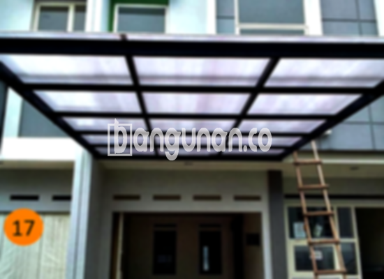

**Jasa Pasang Kanopi Rumah Minimalis di Ngawi** – Mencari solusi perlindungan optimal untuk teras atau garasi rumah Anda di Ngawi? Kanopi adalah jawaban tepat yang tidak hanya melindungi dari cuaca ekstrem, tetapi juga meningkatkan estetika bangunan. Mitra Bangunan di Ngawi hadir untuk mewujudkan kenyamanan hunian Anda dengan penyediaan dan pemasangan kanopi berkualitas dan terjangkau.

Kanopi hadir dalam beragam material, seperti galvalum dan besi hollo. Anda dapat memilih jenis kanopi yang paling sesuai dengan kebutuhan dan preferensi estetika Anda. Setiap material memiliki kelebihan dan kekurangan tersendiri, sehingga memastikan Anda mendapatkan solusi yang optimal.

Bagi Anda yang berencana memasang kanopi untuk rumah, terdapat banyak manfaat yang bisa didapatkan, mulai dari perlindungan terhadap sinar matahari dan hujan, hingga peningkatan nilai estetika bangunan. Kanopi juga menawarkan manfaat tambahan yang signifikan bagi rumah Anda.



## Harga Kanopi Rumah Minimalis di Ngawi

Apakah Anda sedang mempertimbangkan untuk membeli kanopi untuk hunian Anda? Sebelum melakukan pemesanan, ada baiknya Anda memahami terlebih dahulu perkiraan harga kanopi rumah. Dengan membandingkan berbagai harga, Anda dapat menemukan kanopi yang paling sesuai dengan anggaran dan kebutuhan Anda.

Terdapat beberapa faktor yang memengaruhi harga kanopi, di antaranya:

### \- Material yang Digunakan oleh Jasa Pasang Kanopi Rumah Minimalis di Ngawi

Pemilihan material merupakan pertimbangan utama dalam menentukan kanopi yang tepat. Tersedia berbagai pilihan material, seperti besi, baja ringan, dan lainnya. Anda dapat memilih jenis kanopi yang sesuai dengan preferensi Anda, dengan mempertimbangkan bahwa setiap material memiliki harga yang berbeda-beda.

### \- Model Kanopi dari Jasa Pasang Kanopi Rumah Minimalis di Ngawi

Model kanopi juga memengaruhi harga yang ditawarkan. Anda dapat memilih model yang sesuai dengan gaya arsitektur rumah Anda. Tersedia beragam pilihan model yang dapat Anda pertimbangkan, dan Anda dapat mencari referensi inspirasi dari berbagai sumber.

### \- Ukuran Kanopi

Selain jenis dan material, ukuran kanopi juga turut memengaruhi harga. Pastikan Anda mengukur area yang akan ditutupi kanopi dengan akurat. Setiap kanopi rumah memiliki ukuran yang berbeda, sehingga pengukuran yang tepat sangat penting.

Dengan memahami faktor-faktor ini, Anda akan dapat membuat keputusan yang tepat dalam memilih kanopi yang sesuai dengan kebutuhan dan anggaran Anda. Kualitas yang lebih baik tentu akan berpengaruh pada harga yang ditawarkan.

## Rekomendasi Ragam Kanopi Rumah Minimalis di Ngawi



Untuk Anda yang berencana memasang kanopi untuk rumah, terdapat berbagai jenis kanopi yang dapat Anda pilih. Salah satu jenis kanopi yang populer dan efisien adalah kanopi berbahan baja ringan. Jenis kanopi ini menawarkan berbagai keunggulan dibandingkan material lainnya. Berikut beberapa keunggulan yang dapat Anda pertimbangkan:

### \- Kekuatan dan Daya Tahan

Setiap orang yang ingin membeli kanopi untuk rumahnya tentu menginginkan kekuatan dan daya tahan yang optimal. Kanopi yang terbuat dari bahan galvalum memiliki kualitas yang sangat baik, menawarkan kekokohan yang terjamin dan umur pakai yang panjang.

Banyak orang telah membuktikan keawetan kanopi baja ringan, yang dapat bertahan selama puluhan tahun dengan perawatan yang tepat. 

### \- Beragam Pilihan Model dari Jasa Pasang Kanopi Rumah Minimalis di Ngawi

Bagi Anda yang ingin memasang kanopi untuk bangunan komersial atau rumah, Anda dapat memilih dari berbagai model yang tersedia. Kanopi baja ringan menawarkan fleksibilitas dalam desain, memungkinkan Anda untuk menemukan model yang sesuai dengan selera dan kebutuhan Anda. Keunggulan ini menjadikannya pilihan yang menarik bagi banyak orang.

### \- Keamanan yang Optimal dari Jasa Pasang Kanopi Rumah Minimalis di Ngawi

Material galvalum dikenal dengan kekuatannya yang tinggi, sehingga menawarkan tingkat keamanan yang superior. Anda akan mendapatkan perlindungan yang maksimal jika menggunakan kanopi baja ringan. Risiko kerusakan atau roboh dapat diminimalkan secara signifikan dengan penggunaan material ini.

Jika Anda sedang mencari kanopi untuk rumah Anda di Ngawi, kanopi yang terbuat dari bahan galvalum merupakan pilihan yang sangat efektif. Banyak keunggulan yang dapat Anda peroleh dengan memilih jenis kanopi ini. 

Dengan layanan kami di Ngawi, Anda akan mendapatkan kanopi terbaik yang sesuai dengan kebutuhan Anda.

**Ref by:**  [Kanopi Rumah Minimalis Ngawi](https://id.wikipedia.org/wiki/Kanopi)

Mitra Bangunan yang sedang mencari jasa pasang kanopi di Ngawi, jangan ragu untuk menghubungi kami melalui tombol WhatsApp atau Telepon yang tersedia di halaman ini. Kami siap membantu Anda mewujudkan hunian impian Anda.