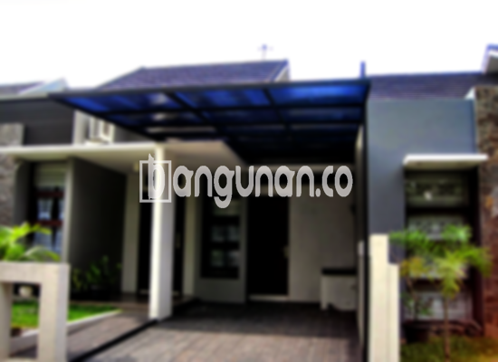

**Jasa Pasang Kanopi Rumah Minimalis di Pabaton Bogor** – Memiliki area luar rumah yang nyaman dan terlindungi adalah dambaan setiap warga Pabaton Bogor. Kanopi hadir sebagai solusi praktis untuk menjaga teras, garasi, atau area parkir dari sengatan matahari dan hujan deras. Bagi Mitra Bangunan di Pabaton Bogor, mencari penyedia jasa pemasangan kanopi yang terpercaya adalah langkah tepat untuk menciptakan hunian yang lebih nyaman dan fungsional. Kami hadir untuk memberikan solusi kanopi berkualitas dengan harga terjangkau.

Kanopi tidak hanya berfungsi sebagai pelindung, tetapi juga meningkatkan estetika rumah Anda. Tersedia berbagai pilihan material, mulai dari baja ringan yang ekonomis hingga kaca yang elegan. Memilih jenis kanopi yang tepat akan sangat memengaruhi tampilan dan ketahanan bangunan Anda. 

Mari kita bahas lebih lanjut mengenai manfaat dan jenis-jenis kanopi yang bisa Anda aplikasikan untuk rumah atau ruko Anda di Pabaton Bogor. Dengan memahami berbagai opsi yang tersedia, Anda dapat membuat keputusan yang paling sesuai dengan kebutuhan dan anggaran Anda.



## Harga Kanopi Rumah Minimalis di Pabaton Bogor

Tertarik untuk memasang kanopi pada bangunan Anda di Pabaton Bogor? Tentu saja, aspek harga menjadi pertimbangan penting dalam setiap keputusan. Sebelum melakukan pemesanan, sebaiknya Anda memahami faktor-faktor yang memengaruhi harga kanopi rumah. Dengan mengetahui hal ini, Anda dapat merencanakan anggaran dengan lebih baik dan memilih kanopi yang sesuai dengan kebutuhan Anda. 

Penentuan harga kanopi dipengaruhi oleh beberapa faktor utama, di antaranya:

### \- Jenis Bahan yang Digunakan

Bahan merupakan salah satu penentu harga utama. Berbagai material seperti besi, baja ringan, dan kaca memiliki harga yang bervariasi. Anda dapat memilih material yang paling sesuai dengan anggaran dan preferensi estetika Anda. Setiap bahan memiliki kelebihan dan kekurangan masing-masing.

### \- Desain dan Model Kanopi

Model kanopi juga berperan dalam penentuan harga. Apakah Anda menginginkan kanopi sederhana atau dengan desain yang lebih rumit? Semakin kompleks desainnya, semakin tinggi pula biaya pembuatannya. Kami menyediakan berbagai pilihan model kanopi yang dapat Anda sesuaikan dengan gaya arsitektur rumah Anda.

### \- Ukuran dan Luas Kanopi

Luas area yang akan ditutupi oleh kanopi juga memengaruhi harga. Semakin luas area yang dicakup, semakin banyak material yang dibutuhkan, dan semakin tinggi biayanya. Penting untuk melakukan pengukuran yang akurat sebelum memesan kanopi.

Untuk informasi harga yang lebih detail dan sesuai dengan kebutuhan spesifik Anda di Pabaton Bogor, kami sarankan untuk menghubungi tim kami. Kami akan memberikan penawaran terbaik dan solusi kanopi yang tepat untuk Anda.

## Rekomendasi Jenis Kanopi Rumah Minimalis di Pabaton Bogor



Bagi Anda yang berencana memasang kanopi untuk bangunan komersial seperti ruko di Pabaton Bogor, ada banyak pilihan jenis kanopi yang dapat Anda pertimbangkan. Salah satu yang paling populer adalah kanopi berbahan baja ringan. Material ini menawarkan sejumlah keuntungan dibandingkan material lain. Mari kita bahas lebih dalam keunggulan kanopi baja ringan.

### \- Kekuatan dan Ketahanan yang Terjamin

Kekuatan dan ketahanan adalah faktor utama yang perlu dipertimbangkan saat memilih kanopi. Kanopi yang terbuat dari baja ringan dikenal sangat kuat dan tahan lama. Material ini mampu menahan beban angin kencang dan kondisi cuaca ekstrem lainnya.

Banyak pengguna yang telah membuktikan kekokohan kanopi baja ringan. Dengan perawatan yang tepat, kanopi ini dapat bertahan selama bertahun-tahun tanpa masalah.

### \- Pilihan Desain yang Variatif

Kanopi baja ringan menawarkan fleksibilitas dalam desain. Anda dapat memilih berbagai model dan bentuk sesuai dengan preferensi Anda. Model yang beragam memungkinkan Anda menciptakan tampilan yang unik dan sesuai dengan gaya arsitektur bangunan Anda.

### \- Tingkat Keamanan yang Tinggi

Baja ringan adalah material yang kuat dan aman. Kanopi yang terbuat dari baja ringan memiliki risiko kerusakan atau roboh yang sangat kecil. Anda dapat merasa tenang dan nyaman dengan kanopi yang terpasang dengan baik.

Bagi Anda yang mencari solusi kanopi yang andal dan tahan lama di Pabaton Bogor, kanopi baja ringan adalah pilihan yang sangat tepat. Keunggulan yang ditawarkannya menjadikannya investasi yang cerdas untuk properti Anda.

**Ref by:**  [Kanopi Rumah Minimalis Pabaton Bogor](https://id.wikipedia.org/wiki/Kanopi)

Dengan layanan pemasangan kanopi profesional dari kami, Mitra Bangunan di Pabaton Bogor dapat menikmati kenyamanan dan keamanan yang lebih baik. Jangan ragu untuk menghubungi kami melalui tombol WhatsApp atau Telepon di halaman ini untuk konsultasi gratis dan penawaran terbaik!