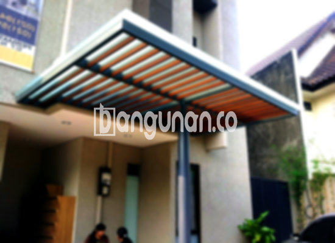

**Jasa Pasang Kanopi Rumah Minimalis di Padaherang** – Memiliki area luar rumah yang nyaman dan terlindungi adalah dambaan setiap pemilik rumah di Padaherang. Kanopi menjadi solusi yang tepat untuk melindungi teras, garasi, atau area terbuka lainnya dari sengatan matahari dan guyuran hujan. Sebagai Mitra Bangunan, Anda berhak mendapatkan solusi terbaik untuk kenyamanan hunian Anda. Kami hadir sebagai penyedia jasa pembuatan dan pemasangan kanopi berkualitas dengan harga terjangkau di wilayah Padaherang.

Kanopi hadir dalam berbagai pilihan material, seperti baja ringan dan besi hollo, masing-masing menawarkan keunggulan dan kekurangan tersendiri. Anda dapat memilih jenis kanopi yang paling sesuai dengan kebutuhan dan anggaran Anda.



## Harga Kanopi Rumah Minimalis di Padaherang

Pertanyaan tentang biaya seringkali muncul ketika Anda berencana memasang kanopi. Sebelum melakukan pembelian, ada baiknya Anda memahami faktor-faktor yang memengaruhi harga kanopi rumah. Dengan memahami hal ini, Anda bisa membuat perencanaan anggaran yang lebih efektif dan memilih kanopi yang sesuai dengan harapan Anda.

Berikut beberapa faktor yang memengaruhi harga kanopi:

### – Material yang Digunakan

Jenis material yang digunakan merupakan faktor utama yang menentukan harga kanopi. Pilihan material seperti besi, baja ringan, atau polycarbonate memiliki harga yang berbeda-beda. Anda dapat memilih material yang paling sesuai dengan kebutuhan dan anggaran Anda.

### – Model Kanopi

Model kanopi juga memengaruhi harga jualnya. Terdapat beragam model kanopi yang tersedia, mulai dari yang sederhana hingga yang lebih kompleks. Anda bisa memilih model yang selaras dengan desain rumah Anda.

### – Ukuran Kanopi

Ukuran kanopi juga berperan penting dalam menentukan harga. Semakin besar ukuran kanopi, semakin banyak material yang dibutuhkan, dan semakin tinggi pula biayanya. Pastikan Anda mengukur area yang akan dipasang kanopi dengan tepat sebelum melakukan pemesanan.

Untuk mengetahui informasi lebih detail mengenai harga kanopi, Anda dapat melihat tabel harga yang tersedia  atau menghubungi tim kami untuk mendapatkan penawaran harga yang sesuai dengan kebutuhan Anda.

## Rekomendasi Jenis Kanopi Rumah Minimalis di Padaherang

**Ref by:**  [Kanopi Rumah Minimalis Padaherang](https://id.wikipedia.org/wiki/Kanopi)

Bagi Anda yang ingin memasang kanopi untuk rumah di Padaherang, terdapat berbagai jenis kanopi yang bisa Anda pertimbangkan. Salah satu yang paling populer adalah kanopi berbahan baja ringan. Material ini menawarkan sejumlah keunggulan dibandingkan material lainnya.

### – Kekuatan dan Ketahanan

Kekuatan adalah faktor krusial dalam memilih kanopi. Kanopi berbahan galvalum (baja ringan) dikenal memiliki kualitas yang sangat baik. Dengan kekokohan yang terjamin, kanopi ini dapat bertahan lama dan melindungi Anda dari berbagai kondisi cuaca. 

Penggunaan baja ringan juga seringkali menjadi pilihan karena ketahanannya terhadap korosi, menjadikannya pilihan jangka panjang yang bijak.

### – Desain yang Bervariasi

Kanopi baja ringan hadir dalam beragam desain yang dapat Anda sesuaikan dengan gaya arsitektur rumah Anda. Fleksibilitas ini memungkinkan Anda untuk menciptakan tampilan yang harmonis dan estetis.

### – Keamanan Terjamin

Baja ringan adalah material yang kokoh dan aman digunakan. Anda dapat merasa tenang mengetahui bahwa kanopi Anda akan memberikan perlindungan yang optimal bagi Anda dan keluarga. Risiko kerusakan atau roboh sangat minim jika Anda memilih kanopi baja ringan berkualitas.

Dengan berbagai keunggulannya, kanopi berbahan baja ringan menjadi pilihan yang tepat bagi Anda yang mencari solusi perlindungan yang kuat, tahan lama, dan estetis untuk rumah Anda di Padaherang. 

Kami siap membantu Anda mewujudkan hunian yang nyaman dan terlindungi dengan kanopi berkualitas. Jangan ragu untuk menghubungi kami melalui tombol WhatsApp atau Telepon di halaman ini untuk konsultasi dan pemesanan. Sebagai Mitra Bangunan, Kami akan memberikan solusi terbaik untuk kebutuhan Anda.