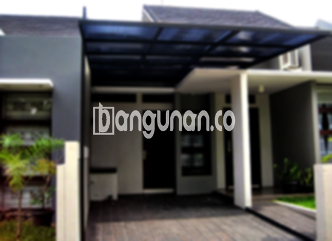

**Jasa Pasang Kanopi Rumah Minimalis di Padalarang** – Menciptakan kenyamanan dan estetika di sekitar rumah adalah dambaan setiap pemilik properti. Kanopi menjadi solusi tepat untuk melindungi teras, garasi, atau area terbuka lainnya dari panas matahari dan hujan. Mitra Bangunan di Padalarang memahami kebutuhan Anda akan kanopi yang berkualitas dan terjangkau untuk rumah impian Anda. Kami hadir sebagai penyedia jasa borongan pembuatan dan pemasangan kanopi yang terpercaya di wilayah Padalarang dan sekitarnya.

Kanopi hadir dalam beragam material, seperti galvalum dan besi hollo. Pemilihan material ini penting untuk disesuaikan dengan kebutuhan estetika dan anggaran Anda. Setiap material memiliki kelebihan dan kekurangan masing-masing yang akan memengaruhi tampilan dan ketahanan kanopi yang Anda pilih.

Investasi dalam kanopi akan memberikan banyak manfaat bagi hunian Anda. Selain perlindungan dari cuaca ekstrem, kanopi juga dapat meningkatkan nilai estetika rumah dan menciptakan area luar ruangan yang lebih nyaman untuk bersantai dan berkumpul bersama keluarga.



## Harga Kanopi Rumah Minimalis di Padalarang

Apakah Anda sedang merencanakan pemasangan kanopi untuk rumah di Padalarang? Mengetahui perkiraan harga kanopi rumah terlebih dahulu adalah langkah yang bijak. Dengan membandingkan berbagai opsi, Anda dapat memastikan mendapatkan kanopi yang sesuai dengan anggaran dan preferensi Anda. 

Terdapat beberapa faktor utama yang memengaruhi harga kanopi, antara lain:

### \- Bahan yang Digunakan oleh Jasa Pasang Kanopi Rumah Minimalis di Padalarang

Pemilihan bahan menjadi pertimbangan penting dalam menentukan harga kanopi. Berbagai jenis bahan seperti besi, baja ringan, dan polycarbonate tersedia dengan karakteristik dan harga yang berbeda. Anda dapat memilih bahan yang paling sesuai dengan kebutuhan dan anggaran Anda.

### \- Model Kanopi dari Jasa Pasang Kanopi Rumah Minimalis di Padalarang

Model kanopi juga berperan dalam menentukan harga. Terdapat banyak pilihan desain, mulai dari yang sederhana hingga yang lebih kompleks. Semakin rumit desainnya, biasanya semakin tinggi pula harganya.

### \- Luas Kanopi

Ukuran atau luas kanopi yang Anda butuhkan juga akan memengaruhi biaya. Semakin luas kanopi yang dibutuhkan, tentu saja semakin banyak material yang diperlukan, sehingga harga juga akan meningkat.

Untuk informasi detail mengenai harga, Anda dapat melihat tabel harga yang tersedia  atau menghubungi tim kami untuk mendapatkan penawaran khusus yang disesuaikan dengan kebutuhan Anda.

## Pilihan Jenis Kanopi Rumah Minimalis di Padalarang

Jika Anda sedang mempertimbangkan kanopi untuk ruko atau bangunan komersial lainnya, ada banyak pilihan material yang bisa Anda eksplorasi. Kanopi berbahan baja ringan merupakan salah satu opsi yang populer karena menawarkan kombinasi kekuatan dan efisiensi biaya yang baik. Berikut beberapa keunggulan yang dapat Anda peroleh:

### \- Kekuatan dan Ketahanan Tinggi

Kekuatan merupakan aspek krusial yang perlu diperhatikan saat memilih kanopi. Kanopi yang terbuat dari bahan galvalum atau baja ringan terkenal akan kualitasnya yang prima. Bahan ini dirancang untuk tahan terhadap berbagai kondisi cuaca dan memiliki umur pakai yang panjang.

Dengan memilih kanopi baja ringan, Anda dapat yakin bahwa investasi Anda akan bertahan selama bertahun-tahun tanpa perlu khawatir akan kerusakan atau penggantian dini.

### \- Desain Fleksibel

Kanopi baja ringan menawarkan fleksibilitas desain yang luar biasa. Anda dapat memilih dari berbagai model dan gaya yang tersedia, atau bahkan memesan desain khusus sesuai dengan preferensi Anda. Fleksibilitas ini memungkinkan Anda untuk menciptakan kanopi yang sesuai dengan karakter arsitektur bangunan Anda.

### \- Keamanan Terjamin

Keamanan adalah prioritas utama dalam konstruksi kanopi. Baja ringan adalah material yang kuat dan stabil, sehingga dapat memberikan perlindungan yang optimal terhadap berbagai risiko. Dengan kanopi baja ringan, Anda dapat merasa tenang dan nyaman karena area di bawahnya terlindungi dengan baik.

Pilihan kanopi baja ringan adalah solusi cerdas bagi Anda yang menginginkan kanopi yang kuat, tahan lama, dan aman. 

Untuk Mitra Bangunan yang sedang mempertimbangkan jasa pasang kanopi di Padalarang, jangan ragu untuk menghubungi kami melalui tombol WhatsApp atau Telepon di halaman ini. Kami siap memberikan konsultasi gratis dan membantu Anda memilih kanopi yang paling sesuai dengan kebutuhan dan anggaran Anda.

**Ref by:**  [Kanopi Rumah Minimalis Padalarang](https://id.wikipedia.org/wiki/Kanopi)