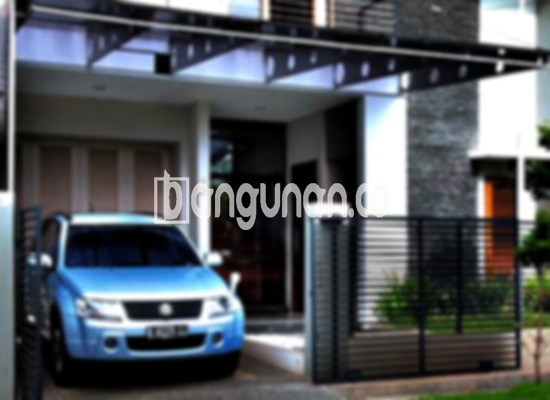

**Jasa Pasang Kanopi Rumah Minimalis di Pademangan Jakarta** – Apakah Anda sedang merencanakan pemasangan kanopi untuk rumah atau bangunan komersial di Pademangan Jakarta? Kanopi berperan penting dalam melindungi area luar ruangan dari cuaca ekstrem, sekaligus meningkatkan estetika properti Anda. Mitra Bangunan hadir sebagai solusi terpercaya untuk kebutuhan kanopi berkualitas dengan harga yang kompetitif di wilayah Pademangan Jakarta. Kami siap mewujudkan tampilan rumah idaman Anda dengan kanopi yang sesuai dengan gaya dan anggaran Anda.

Ada beragam jenis kanopi yang dapat Anda pilih, masing-masing menawarkan keunggulan unik untuk memenuhi kebutuhan spesifik. Kanopi baja ringan, misalnya, dikenal karena kekuatannya dan kemudahan pemasangannya. Sementara itu, kanopi kaca memberikan kesan modern dan elegan, serta memungkinkan cahaya alami masuk ke dalam ruangan. Berikut adalah beberapa pilihan populer yang tersedia untuk Anda:

*   Kanopi Baja Ringan: Ringan, kuat, dan tahan karat.
*   Kanopi Galvalum: Pilihan ekonomis dengan daya tahan yang baik.
*   Kanopi Kaca: Memberikan tampilan modern dan mewah.
*   Kanopi Polycarbonate: Tahan benturan dan memberikan perlindungan dari sinar UV.



## Estimasi Biaya Kanopi Rumah Minimalis di Pademangan Jakarta

Mempertimbangkan anggaran adalah langkah penting dalam setiap proyek pembangunan, termasuk pemasangan kanopi. Sebelum memutuskan jenis dan ukuran kanopi, Anda perlu memahami faktor-faktor yang memengaruhi harga. Dengan begitu, Anda dapat membuat keputusan yang lebih cerdas dan sesuai dengan kebutuhan Anda di Pademangan Jakarta.

Beberapa faktor utama yang memengaruhi harga kanopi meliputi:

### \- Jenis Material yang Digunakan

Pemilihan material kanopi berdampak signifikan terhadap harga. Material seperti baja ringan dan galvalum umumnya lebih terjangkau dibandingkan dengan kaca atau polycarbonate. Anda dapat menyesuaikan pilihan material dengan anggaran dan preferensi estetika Anda.

### \- Model dan Desain Kanopi

Model kanopi yang kompleks dan unik biasanya membutuhkan biaya lebih tinggi daripada desain sederhana. Pilihlah model yang sesuai dengan gaya arsitektur bangunan Anda dan sesuaikan dengan anggaran yang tersedia.

### \- Ukuran dan Luas Area Kanopi

Ukuran kanopi secara langsung memengaruhi biaya produksi dan pemasangan. Semakin luas area yang akan ditutupi, semakin banyak material yang dibutuhkan, dan semakin tinggi pula biayanya. Pastikan Anda mengukur area yang akan dipasang kanopi dengan akurat sebelum meminta penawaran harga.

Untuk mendapatkan informasi harga yang lebih rinci dan sesuai dengan kebutuhan Anda, silakan lihat tabel harga kami  atau hubungi tim kami untuk konsultasi gratis. Kami akan membantu Anda menemukan solusi kanopi terbaik dengan harga yang kompetitif di Pademangan Jakarta.

## Keunggulan Memilih Jasa Pasang Kanopi di Pademangan Jakarta

**Ref by:**  [Kanopi Rumah Minimalis Pademangan Jakarta](https://id.wikipedia.org/wiki/Kanopi)

Mempercayakan pemasangan kanopi kepada profesional adalah investasi yang bijak. Dengan pengalaman dan keahlian yang kami miliki, kami dapat memastikan pemasangan kanopi yang rapi, kuat, dan tahan lama. Berikut adalah beberapa keunggulan yang Anda dapatkan ketika memilih jasa kami:

### \- Kualitas Bahan Terbaik

Kami hanya menggunakan bahan-bahan berkualitas tinggi yang telah teruji kekuatannya dan tahan terhadap cuaca ekstrem. Hal ini memastikan kanopi yang kami pasang akan bertahan lama dan memberikan perlindungan optimal bagi properti Anda. Anda akan mendapatkan nilai investasi yang maksimal dengan memilih layanan kami.

### \- Pemasangan Profesional dan Rapi

Tim pemasang kami terdiri dari tenaga ahli yang berpengalaman dan terlatih. Mereka akan memastikan pemasangan kanopi dilakukan secara profesional, rapi, dan sesuai dengan standar keamanan yang berlaku. Anda tidak perlu khawatir tentang kualitas pemasangan, karena kami memberikan jaminan kepuasan pelanggan.

### \- Desain yang Sesuai dengan Kebutuhan Anda

Kami menawarkan berbagai pilihan desain kanopi yang dapat disesuaikan dengan gaya arsitektur bangunan Anda. Anda dapat memilih desain yang paling sesuai dengan selera Anda, atau meminta kami untuk membuat desain khusus sesuai dengan kebutuhan Anda.

Kanopi tidak hanya berfungsi sebagai pelindung dari cuaca, tetapi juga dapat meningkatkan nilai estetika properti Anda. Dengan memilih jasa pasang kanopi profesional di Pademangan Jakarta, Anda dapat memiliki kanopi yang indah, kuat, dan tahan lama.

Mitra Bangunan siap membantu Anda mewujudkan hunian yang nyaman dan terlindungi dengan kanopi berkualitas. Hubungi kami melalui tombol WhatsApp atau Telepon di halaman ini untuk mendapatkan penawaran terbaik dan konsultasi gratis. Jangan tunda lagi, lindungi investasi Anda dengan kanopi yang tepat! 