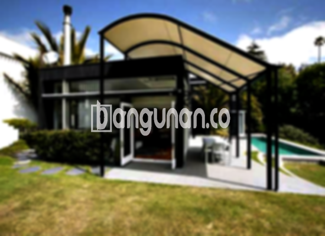

**Jasa Pasang Kanopi Rumah Minimalis di Pakisjaya Karawang** – Memiliki area luar rumah yang nyaman dan terlindungi dari cuaca ekstrem adalah dambaan setiap pemilik properti di Pakisjaya Karawang. Kanopi hadir sebagai solusi praktis dan estetis untuk menciptakan ruang terbuka yang dapat dinikmati sepanjang tahun. Mitra Bangunan kini dapat mewujudkan hunian impian dengan kanopi berkualitas dan terjangkau.

Kanopi bukan sekadar pelindung rumah; ia juga elemen penting dalam desain eksterior. Tersedia berbagai material untuk pembuatan kanopi, seperti galvalum dan besi hollo, masing-masing dengan karakteristik dan keunggulan tersendiri. Anda dapat memilih jenis kanopi yang paling sesuai dengan gaya arsitektur dan kebutuhan spesifik Anda.

Pemasangan kanopi di ruko, teras, atau garasi memberikan manfaat signifikan, terutama dalam melindungi dari sengatan matahari dan guyuran hujan. Lebih dari itu, kanopi juga berperan penting dalam meningkatkan nilai estetika bangunan serta menciptakan suasana yang lebih nyaman.



## Estimasi Biaya Kanopi Rumah Minimalis di Pakisjaya Karawang

Apakah Anda sedang merencanakan pemasangan kanopi untuk rumah atau bangunan komersial? Memahami perkiraan biaya menjadi langkah awal yang bijak sebelum memulai proyek. Anda dapat membandingkan estimasi dari berbagai penyedia jasa untuk mendapatkan penawaran terbaik yang sesuai dengan anggaran Anda.

Terdapat beberapa faktor utama yang memengaruhi harga kanopi, antara lain:

### - Material yang Digunakan

Pemilihan material merupakan pertimbangan penting dalam menentukan biaya kanopi. Material yang umum digunakan antara lain besi, baja ringan, dan polycarbonate, yang masing-masing memiliki tingkat harga yang berbeda. Anda dapat memilih material yang sesuai dengan preferensi dan anggaran Anda.

### - Desain dan Model Kanopi

Desain kanopi juga memengaruhi biaya pemasangan. Model yang rumit dan memiliki banyak detail tentu akan membutuhkan biaya yang lebih tinggi dibandingkan dengan model yang sederhana. Kami menyediakan berbagai pilihan model kanopi yang dapat Anda sesuaikan dengan gaya arsitektur bangunan Anda.

### - Ukuran Kanopi

Luas area yang akan ditutupi oleh kanopi turut memengaruhi biaya pemasangan. Semakin besar ukuran kanopi, semakin banyak material yang dibutuhkan dan semakin tinggi pula biayanya. Pastikan Anda mengukur area dengan tepat sebelum melakukan pemesanan.

Dengan memahami faktor-faktor ini, Anda dapat membuat perencanaan anggaran yang lebih akurat. Kami siap membantu Anda menghitung estimasi biaya kanopi sesuai dengan kebutuhan dan spesifikasi bangunan Anda. 

### Saran Pilihan Kanopi Rumah Minimalis di Pakisjaya Karawang

Bagi Anda yang berencana memasang kanopi untuk rumah atau ruang usaha di Pakisjaya Karawang, tersedia banyak pilihan material yang dapat Anda pertimbangkan. Salah satu material yang populer dan direkomendasikan adalah kanopi berbahan baja ringan. Berikut ini beberapa keunggulan yang ditawarkan oleh kanopi baja ringan:

### - Ketahanan dan Kekokohan Terjamin

Salah satu pertimbangan utama dalam memilih kanopi adalah ketahanan dan kekokohannya. Kanopi berbahan baja ringan dikenal memiliki kualitas yang sangat baik dan mampu menahan berbagai kondisi cuaca ekstrem. Kekokohannya terjamin, sehingga dapat digunakan untuk jangka waktu yang lama.

Banyak pengguna telah membuktikan kekuatan dan daya tahan kanopi baja ringan. Material ini mampu bertahan selama bertahun-tahun tanpa mengalami kerusakan yang signifikan.

### - Variasi Model yang Luas

Kanopi baja ringan tersedia dalam berbagai macam model dan desain yang dapat Anda pilih sesuai dengan selera dan gaya arsitektur bangunan Anda. Variasi model ini memberikan Anda kebebasan untuk menciptakan tampilan yang unik dan sesuai dengan visi Anda.

### - Tingkat Keamanan yang Lebih Tinggi

Baja ringan merupakan material yang memiliki tingkat kekokohan yang tinggi, sehingga memberikan tingkat keamanan yang lebih baik dibandingkan dengan material lain. Anda dapat merasa tenang dan nyaman karena kanopi baja ringan mampu melindungi Anda dari berbagai risiko, seperti kerusakan akibat angin kencang atau hujan deras.

Untuk Anda yang ingin memasang kanopi untuk ruko atau bangunan lain di Pakisjaya Karawang, kanopi berbahan galvalum juga dapat menjadi pilihan yang tepat. Terdapat berbagai keunggulan yang dapat Anda nikmati dengan menggunakan jenis kanopi ini.

Semoga informasi ini bermanfaat bagi Anda. Silakan hubungi kami melalui tombol WhatsApp atau Telepon di halaman ini untuk konsultasi dan pemesanan kanopi berkualitas di Pakisjaya Karawang. Mitra Bangunan siap membantu Anda mewujudkan hunian yang nyaman dan terlindungi.

**Ref by:**  [Kanopi Rumah Minimalis Pakisjaya Karawang](https://id.wikipedia.org/wiki/Kanopi)