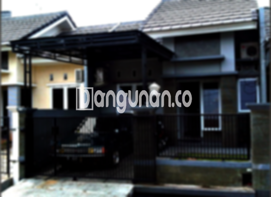

**Jasa Pasang Kanopi Rumah Minimalis di Pakuan Bogor** – Memiliki area luar rumah yang nyaman dan terlindungi adalah dambaan setiap pemilik rumah di Pakuan Bogor. Kanopi hadir sebagai solusi praktis untuk menjaga teras, garasi, atau carport dari sengatan matahari dan hujan deras. Mitra Bangunan memahami betul kebutuhan Anda akan perlindungan optimal dan estetika yang harmonis untuk hunian di Pakuan Bogor.

Kanopi tersedia dalam berbagai material, seperti galvalum dan besi hollo, masing-masing dengan karakteristik unik. Memilih material yang tepat akan menentukan kekuatan, tampilan, dan tentu saja, anggaran yang sesuai dengan kebutuhan Anda. Kami di sini untuk membantu Anda memilih solusi kanopi yang paling ideal.



## Harga Kanopi Rumah Minimalis di Pakuan Bogor

Berapa biaya yang perlu Anda siapkan untuk mendapatkan kanopi impian? Pertanyaan ini wajar muncul sebelum menentukan langkah selanjutnya. Sebelum memesan kanopi rumah, sebaiknya Anda memahami dahulu faktor-faktor yang memengaruhi harga. Dengan begitu, Anda bisa membuat perencanaan anggaran yang lebih realistis dan memilih kanopi yang paling sesuai dengan kemampuan Anda.

Harga kanopi dapat bervariasi tergantung pada beberapa aspek penting, antara lain:

### - Material yang Digunakan

Pemilihan material adalah salah satu faktor utama yang memengaruhi harga kanopi. Ada berbagai opsi material yang tersedia, seperti besi, baja ringan, dan polycarbonate, masing-masing dengan rentang harga yang berbeda. Setiap material memiliki kelebihan dan kekurangan yang perlu Anda pertimbangkan.

### - Model dan Desain Kanopi

Model kanopi yang Anda pilih juga akan berpengaruh pada biaya. Kanopi dengan desain yang rumit atau custom biasanya akan lebih mahal dibandingkan dengan model standar. Pertimbangkan gaya arsitektur rumah Anda agar kanopi yang dipilih selaras dengan keseluruhan tampilan.

### - Ukuran dan Luas Kanopi

Ukuran dan luas kanopi juga memainkan peran penting dalam menentukan harga. Semakin besar ukuran kanopi, semakin banyak material yang dibutuhkan, dan semakin tinggi biayanya. Pastikan untuk mengukur area yang ingin ditutup kanopi dengan akurat sebelum melakukan pemesanan.

Untuk informasi lebih detail mengenai harga kanopi, kami sarankan untuk melihat tabel harga yang tersedia . Atau, jangan ragu untuk menghubungi tim kami untuk mendapatkan penawaran harga yang disesuaikan dengan kebutuhan Anda.

## Rekomendasi Jenis Kanopi Rumah Minimalis di Pakuan Bogor

Jenis kanopi baja ringan adalah salah satu pilihan yang paling populer di kalangan pemilik rumah di Pakuan Bogor. Material ini menawarkan kombinasi ideal antara kekuatan, durabilitas, dan harga yang terjangkau. Berikut adalah beberapa keunggulan yang bisa Anda dapatkan:

### - Keawetan dan Kekuatan Optimal

Kekuatan dan keawetan merupakan faktor utama yang perlu dipertimbangkan saat memilih kanopi. Kanopi baja ringan dikenal memiliki mutu yang sangat baik dan mampu menahan berbagai kondisi cuaca ekstrem. Anda tidak perlu khawatir akan kerusakan akibat angin kencang atau hujan deras.

Kanopi baja ringan juga memiliki masa pakai yang panjang, bahkan bisa bertahan hingga puluhan tahun dengan perawatan yang tepat. Investasi pada kanopi baja ringan akan memberikan perlindungan jangka panjang bagi properti Anda. 

### - Pilihan Model yang Beragam

Salah satu keunggulan lain dari kanopi baja ringan adalah tersedianya beragam model dan desain. Anda dapat memilih model yang paling sesuai dengan gaya arsitektur rumah Anda, baik itu minimalis, modern, atau klasik. Kami menawarkan berbagai pilihan desain yang dapat disesuaikan dengan preferensi Anda.

### - Tingkat Keamanan yang Tinggi

Keamanan merupakan prioritas utama saat memilih kanopi. Baja ringan merupakan material yang memiliki kekuatan tarik tinggi, sehingga sangat aman digunakan sebagai struktur kanopi. Anda dapat merasa tenang karena kanopi baja ringan kami dirancang untuk memberikan perlindungan maksimal bagi keluarga Anda.

Selain baja ringan, Anda juga bisa mempertimbangkan kanopi galvalum sebagai alternatif yang menarik. Kanopi galvalum menawarkan keunggulan yang serupa dengan baja ringan, yaitu kekuatan, durabilitas, dan harga yang terjangkau. 

**Ref by:**  [Kanopi Rumah Minimalis Pakuan Bogor](https://id.wikipedia.org/wiki/Kanopi)

Dengan berbagai pilihan kanopi yang tersedia, Anda pasti bisa menemukan solusi yang tepat untuk melindungi dan mempercantik rumah Anda di Pakuan Bogor. Jangan ragu untuk berkonsultasi dengan tim ahli kami untuk mendapatkan rekomendasi terbaik. Mitra Bangunan siap membantu Anda mewujudkan hunian impian yang nyaman dan terlindungi. Hubungi kami melalui tombol WhatsApp atau Telepon di halaman ini untuk mendapatkan penawaran harga dan informasi lebih lanjut.