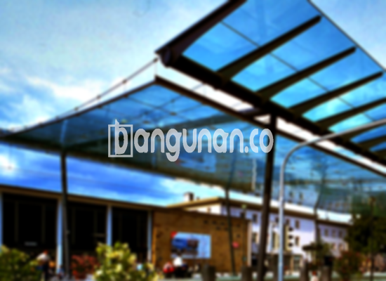

**Jasa Pasang Kanopi Rumah Minimalis di Paledang Bogor** – Mencari solusi untuk melindungi teras, garasi, atau area luar rumah dari cuaca ekstrem di Paledang Bogor? Kanopi adalah jawabannya. Mitra Bangunan hadir sebagai penyedia jasa pemasangan kanopi berkualitas dengan harga terjangkau, siap mewujudkan kenyamanan dan estetika hunian Anda.

Kanopi bukan sekadar pelindung, melainkan juga elemen penting dalam desain eksterior rumah Anda. Tersedia berbagai jenis material, mulai dari baja ringan yang ekonomis hingga kaca yang elegan. Pemilihan material yang tepat akan menentukan tampilan dan ketahanan kanopi Anda.



## Harga Kanopi Rumah Minimalis di Paledang Bogor

Banyak pertanyaan muncul mengenai biaya pemasangan kanopi. Sebelum memutuskan, penting bagi Anda untuk memahami faktor-faktor yang memengaruhi harga kanopi rumah di Paledang Bogor. Dengan memahami hal ini, Anda dapat membuat keputusan yang tepat sesuai dengan anggaran dan kebutuhan Anda.

Berikut adalah beberapa faktor utama yang memengaruhi harga kanopi:

### \- Material yang Digunakan oleh Jasa Pasang Kanopi Rumah Minimalis di Paledang Bogor

Pilihan material merupakan pertimbangan penting. Material seperti besi, baja ringan, dan polycarbonate memiliki karakteristik dan harga yang berbeda. Anda dapat memilih material yang paling sesuai dengan preferensi estetika dan anggaran Anda.

### \- Model Kanopi dari Jasa Pasang Kanopi Rumah Minimalis di Paledang Bogor

Model kanopi juga berperan dalam menentukan harga. Apakah Anda menginginkan model sederhana, minimalis, atau yang lebih kompleks dengan desain khusus? Semakin rumit desainnya, biasanya semakin tinggi pula biayanya.

### \- Ukuran Kanopi

Ukuran area yang akan ditutupi kanopi secara langsung memengaruhi harga. Semakin luas area yang perlu dilindungi, semakin banyak material dan tenaga kerja yang dibutuhkan, dan akibatnya, semakin tinggi biayanya.

Untuk informasi harga yang lebih rinci dan penawaran khusus, silakan merujuk ke tabel harga yang tersedia atau hubungi tim kami untuk konsultasi gratis.

## Rekomendasi Tipe Kanopi Rumah Minimalis di Paledang Bogor



Ketika Anda mempertimbangkan berbagai jenis kanopi untuk rumah Anda di Paledang Bogor, kanopi baja ringan menjadi pilihan yang sangat populer dan menarik untuk dipertimbangkan. Material ini menawarkan kombinasi keunggulan yang sulit ditandingi oleh material lain. 

### \- Keawetan sebagai Keunggulan Utama

Salah satu aspek terpenting saat memilih kanopi adalah keawetannya. Kanopi yang terbuat dari bahan galvalum atau baja ringan dikenal memiliki kualitas yang sangat baik. Ketahanan terhadap korosi dan cuaca ekstrem menjamin kanopi Anda akan bertahan lama.

Banyak pengguna telah membuktikan bahwa kanopi baja ringan dapat bertahan puluhan tahun dengan perawatan yang minimal. Investasi awal yang bijaksana akan memberikan manfaat jangka panjang.

### \- Variasi Model dari Jasa Pasang Kanopi Rumah Minimalis di Paledang Bogor

Fleksibilitas desain adalah keunggulan lain dari kanopi baja ringan. Anda dapat memilih dari berbagai model dan desain yang tersedia, atau bahkan menyesuaikannya dengan preferensi pribadi Anda. Ini memungkinkan Anda menciptakan kanopi yang tidak hanya fungsional tetapi juga mempercantik tampilan rumah Anda.

### \- Keamanan yang Terjamin dari Jasa Pasang Kanopi Rumah Minimalis di Paledang Bogor

Baja ringan dikenal sebagai material yang memiliki kekuatan struktural yang tinggi. Hal ini memastikan kanopi Anda aman dan stabil, bahkan dalam kondisi cuaca buruk. Anda dapat merasa tenang mengetahui bahwa kanopi Anda dapat menahan angin kencang dan beban salju (jika relevan).

Dengan beragam keunggulannya, kanopi baja ringan adalah pilihan yang tepat untuk Anda yang mencari solusi perlindungan yang tahan lama, aman, dan estetis untuk rumah di Paledang Bogor.

**Ref by:**  [Kanopi Rumah Minimalis Paledang Bogor](https://id.wikipedia.org/wiki/Kanopi)

Mitra Bangunan siap membantu Anda menemukan solusi kanopi terbaik untuk rumah Anda di Paledang Bogor. Jangan ragu untuk menghubungi kami melalui tombol WhatsApp atau Telepon di halaman ini untuk mendapatkan konsultasi gratis dan penawaran harga terbaik. Kami berkomitmen untuk memberikan layanan yang profesional dan hasil yang memuaskan.