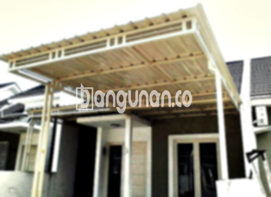

**Jasa Pasang Kanopi Rumah Minimalis di Palmerah Jakarta** – Bagi Mitra Bangunan di Palmerah Jakarta yang sedang merencanakan pembangunan atau renovasi, keberadaan kanopi menjadi elemen penting untuk memberikan kenyamanan dan perlindungan. Apakah Anda memahami apa itu kanopi? Kanopi merupakan struktur atap tambahan yang umumnya digunakan untuk melindungi teras depan rumah, jendela, atau area parkir. Pemasangan kanopi bertujuan untuk melindungi area tersebut dari paparan sinar matahari langsung dan juga hujan, sehingga Anda dapat menikmati waktu di luar ruangan dengan lebih nyaman. Pelataran depan ruko atau toko pun akan terasa lebih terlindungi dengan keberadaan kanopi yang Anda gunakan.

Kanopi tersedia dalam berbagai jenis material, antara lain baja ringan dan besi hollo. Anda dapat memilih material yang paling sesuai dengan preferensi estetika dan anggaran yang Anda miliki. Setiap jenis material memiliki kelebihan dan kekurangan tersendiri yang perlu dipertimbangkan sebelum membuat keputusan.

Bagi Anda yang ingin memasang kanopi untuk rumah atau bangunan komersial, ada berbagai manfaat yang bisa Anda peroleh. Manfaat utamanya adalah perlindungan dari cuaca ekstrem, namun kanopi juga dapat meningkatkan nilai estetika bangunan Anda dan memberikan kenyamanan lebih bagi penghuni atau pelanggan.



## Estimasi Biaya Kanopi Rumah Minimalis di Palmerah Jakarta

Apakah Anda berencana memesan jasa pemasangan kanopi untuk rumah di Palmerah Jakarta? Sebelum melakukan pemesanan, akan sangat bermanfaat jika Anda memahami terlebih dahulu perkiraan biaya yang dibutuhkan. Dengan mengetahui kisaran harga, Anda dapat merencanakan anggaran dengan lebih efektif dan memastikan bahwa kanopi yang Anda pilih sesuai dengan anggaran dan kebutuhan Anda.

Ada beberapa faktor utama yang memengaruhi harga kanopi, di antaranya:

### - Jenis Material yang Digunakan

Pemilihan material merupakan salah satu faktor penentu harga kanopi. Kami menawarkan beragam pilihan material, termasuk besi, baja ringan, polycarbonate, dan kaca. Setiap material memiliki karakteristik dan harga yang berbeda. Konsultasikan dengan tim kami untuk mendapatkan rekomendasi material yang paling sesuai dengan anggaran dan preferensi estetika Anda.

### - Desain dan Model Kanopi

Desain dan model kanopi juga memainkan peran penting dalam menentukan harga. Kami menyediakan berbagai desain kanopi, mulai dari yang sederhana dan minimalis hingga yang lebih kompleks dan mewah. Semakin rumit desainnya, semakin tinggi biaya pembuatannya.

### - Ukuran dan Luas Kanopi

Ukuran dan luas kanopi secara langsung memengaruhi total biaya yang harus Anda keluarkan. Semakin luas area yang ingin ditutupi oleh kanopi, semakin banyak material yang dibutuhkan dan semakin mahal biayanya. Pastikan Anda mengukur area tersebut dengan akurat sebelum memesan.

Setelah mempertimbangkan faktor-faktor tersebut, Anda akan dapat memperkirakan biaya pemasangan kanopi dengan lebih tepat. Kami siap membantu Anda menemukan solusi kanopi yang sesuai dengan anggaran Anda.

## Pilihan Variasi Kanopi Rumah Minimalis di Palmerah Jakarta



Bagi Anda yang berencana untuk memasang kanopi pada bangunan di Palmerah Jakarta, terdapat beragam pilihan material yang dapat dipertimbangkan. Salah satu material yang sering menjadi pilihan adalah kanopi berbahan baja ringan. Material ini menawarkan beberapa keunggulan dibandingkan dengan material lainnya, menjadikannya pilihan yang populer bagi banyak orang.

### - Kekuatan dan Daya Tahan Tinggi

Ketahanan dan kekuatan adalah faktor penting yang perlu dipertimbangkan saat memilih kanopi. Kanopi yang terbuat dari baja ringan dikenal memiliki kekuatan yang luar biasa dan mampu menahan beban berat. Material ini juga tahan terhadap kondisi cuaca ekstrem seperti angin kencang dan hujan deras.

Banyak pengguna yang telah membuktikan daya tahan kanopi baja ringan. Dengan perawatan yang rutin, kanopi ini dapat bertahan hingga bertahun-tahun tanpa memerlukan penggantian.

### - Desain yang Bervariasi

Kami menawarkan berbagai macam desain kanopi baja ringan yang dapat Anda pilih sesuai dengan gaya arsitektur bangunan Anda. Anda dapat memilih desain yang sederhana dan minimalis, atau desain yang lebih artistik dan unik. Keberagaman pilihan desain memungkinkan Anda untuk menciptakan tampilan yang sesuai dengan selera Anda.

### - Keamanan yang Terjamin

Baja ringan merupakan material yang aman dan tidak mudah terbakar, sehingga dapat memberikan perlindungan tambahan bagi bangunan Anda. Dengan menggunakan kanopi baja ringan, Anda dapat merasa lebih tenang dan aman karena risiko kebakaran dapat diminimalisir.

Jika Anda mencari kanopi yang kuat, tahan lama, aman, dan memiliki desain yang menarik, kanopi berbahan baja ringan adalah pilihan yang tepat untuk bangunan Anda di Palmerah Jakarta. Kami siap membantu Anda dalam memilih dan memasang kanopi yang sesuai dengan kebutuhan dan anggaran Anda.

**Ref by:**  [Kanopi Rumah Minimalis Palmerah Jakarta](https://id.wikipedia.org/wiki/Kanopi)

Mitra Bangunan yang sedang mencari jasa pemasangan kanopi berkualitas di Palmerah Jakarta, jangan ragu untuk menghubungi kami melalui tombol WhatsApp atau Telepon yang tersedia di halaman ini. Tim ahli kami siap memberikan konsultasi gratis dan membantu Anda menemukan solusi kanopi yang paling sesuai dengan kebutuhan dan anggaran Anda. Kami berkomitmen untuk memberikan pelayanan terbaik dan hasil yang memuaskan.