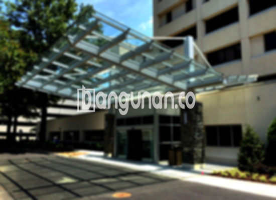

**Jasa Pasang Kanopi Rumah Minimalis di Pamoyanan Bogor** – Menciptakan area luar rumah yang nyaman dan terlindungi adalah prioritas setiap pemilik rumah di Pamoyanan Bogor. Kanopi hadir sebagai solusi praktis untuk melindungi teras, garasi, atau carport dari cuaca ekstrem. Mitra Bangunan memahami kebutuhan ini dan siap membantu Anda mewujudkan hunian impian dengan layanan pemasangan kanopi berkualitas.

Kanopi tidak hanya berfungsi sebagai pelindung, tetapi juga dapat meningkatkan estetika bangunan Anda. Tersedia berbagai jenis kanopi yang dapat disesuaikan dengan gaya arsitektur rumah Anda, mulai dari baja ringan yang ekonomis hingga kaca yang elegan. Pemilihan material yang tepat akan menentukan kekuatan, daya tahan, dan tampilan visual kanopi.



## Harga Kanopi Rumah Minimalis di Pamoyanan Bogor

Tertarik untuk memasang kanopi di rumah Anda di Pamoyanan Bogor? Memahami perkiraan biaya akan membantu Anda dalam perencanaan anggaran. Anda dapat membandingkan berbagai pilihan kanopi dan menyesuaikannya dengan kebutuhan serta anggaran yang tersedia.

Beberapa faktor utama yang memengaruhi harga kanopi meliputi:

### - Material yang Digunakan oleh Jasa Pasang Kanopi Rumah Minimalis di Pamoyanan Bogor

Material merupakan aspek penting yang perlu Anda pertimbangkan ketika memilih kanopi. Pilihan material yang umum termasuk besi, baja ringan, dan polycarbonate. Setiap material memiliki karakteristik dan harga yang berbeda. Anda dapat memilih material yang paling sesuai dengan preferensi estetika, anggaran, dan kebutuhan fungsional Anda.

### - Desain dan Model Kanopi dari Jasa Pasang Kanopi Rumah Minimalis di Pamoyanan Bogor

Desain dan model kanopi juga berperan dalam menentukan harga. Kanopi dengan desain yang rumit atau ukuran yang lebih besar umumnya akan lebih mahal. Tersedia berbagai pilihan model kanopi yang dapat disesuaikan dengan gaya arsitektur rumah Anda. Anda dapat mencari inspirasi desain dari berbagai sumber seperti internet atau katalog.

### - Ukuran dan Luas Area yang Ditutupi

Ukuran dan luas area yang akan ditutupi oleh kanopi juga memengaruhi harga. Semakin besar area yang ditutupi, semakin banyak material yang dibutuhkan dan semakin tinggi biayanya. Pastikan Anda mengukur area yang akan ditutupi dengan tepat sebelum memesan kanopi.

Untuk informasi lebih detail mengenai harga, silakan merujuk pada tabel harga yang tersedia  atau hubungi tim kami untuk konsultasi gratis dan penawaran terbaik. Kami akan membantu Anda menemukan solusi kanopi yang sesuai dengan kebutuhan dan anggaran Anda.

## Pilihan Jenis Kanopi Rumah Minimalis di Pamoyanan Bogor

**Ref by:**  [Kanopi Rumah Minimalis Pamoyanan Bogor](https://id.wikipedia.org/wiki/Kanopi)

Jika Anda sedang mempertimbangkan untuk memasang kanopi di rumah Anda, ada beberapa pilihan yang tersedia. Salah satu opsi yang populer adalah kanopi berbahan baja ringan. Material ini menawarkan kombinasi yang baik antara kekuatan, harga yang terjangkau, dan fleksibilitas desain. Berikut adalah beberapa keunggulan kanopi baja ringan:

### - Kekuatan dan Daya Tahan Tinggi

Baja ringan dikenal dengan kekuatannya yang tinggi dan kemampuannya untuk menahan beban. Kanopi berbahan baja ringan dapat bertahan terhadap kondisi cuaca yang ekstrem seperti angin kencang dan hujan deras. Dengan perawatan yang tepat, kanopi baja ringan dapat bertahan selama bertahun-tahun.

### - Beragam Pilihan Desain dari Jasa Pasang Kanopi Rumah Minimalis di Pamoyanan Bogor

Kanopi baja ringan tersedia dalam berbagai pilihan desain yang dapat disesuaikan dengan gaya arsitektur rumah Anda. Anda dapat memilih model minimalis, modern, atau klasik sesuai dengan preferensi Anda. Fleksibilitas desain ini membuat kanopi baja ringan menjadi pilihan yang populer bagi banyak pemilik rumah di Pamoyanan Bogor.

### - Keamanan Terjamin dari Jasa Pasang Kanopi Rumah Minimalis di Pamoyanan Bogor

Keamanan merupakan faktor penting dalam memilih kanopi. Baja ringan merupakan material yang aman dan tidak mudah terbakar. Selain itu, kanopi baja ringan dapat dirancang untuk menahan beban berat sehingga mengurangi risiko kecelakaan.

Dengan keunggulan-keunggulan tersebut, kanopi baja ringan menjadi pilihan yang ideal untuk melindungi teras, carport, atau area luar rumah Anda di Pamoyanan Bogor.

Mitra Bangunan siap membantu Anda memilih dan memasang kanopi yang sesuai dengan kebutuhan Anda. Jangan ragu untuk menghubungi kami melalui tombol WhatsApp atau Telepon di halaman ini untuk mendapatkan konsultasi gratis dan penawaran terbaik. Kami berkomitmen untuk memberikan layanan berkualitas dan kepuasan pelanggan yang maksimal.