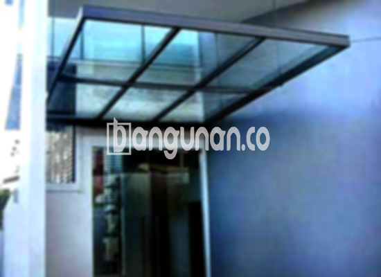

**Jasa Pasang Kanopi Rumah Minimalis di Pamulang Tangerang** – Memiliki area luar rumah yang nyaman dan terlindungi adalah dambaan setiap pemilik hunian di Pamulang Tangerang. Kanopi berperan penting dalam mewujudkannya, melindungi teras, garasi, atau area luar ruangan Anda dari terik matahari dan guyuran hujan. Mitra Bangunan hadir sebagai solusi tepat bagi Anda yang mencari jasa pemasangan kanopi berkualitas dengan harga terjangkau.

Kanopi tersedia dalam berbagai material, seperti baja ringan dan besi hollo. Setiap material menawarkan keunggulan dan kekurangan tersendiri, memungkinkan Anda memilih yang paling sesuai dengan kebutuhan dan anggaran. Dengan berbagai pilihan ini, Anda dapat menemukan kanopi yang sempurna untuk melengkapi desain rumah Anda.

Bagi Anda yang berencana memasang kanopi, terdapat sejumlah manfaat signifikan yang bisa diperoleh. Perlindungan dari cuaca ekstrem adalah fungsi utamanya, namun kanopi juga berkontribusi pada estetika rumah dan memberikan kenyamanan tambahan bagi penghuninya. 



## Pertimbangkan Harga Kanopi Rumah Minimalis di Pamulang Tangerang

Sebelum memutuskan untuk membeli kanopi untuk rumah Anda, penting untuk memahami terlebih dahulu perkiraan harga yang ditawarkan di pasaran. Memahami kisaran harga akan membantu Anda membuat keputusan yang lebih cerdas dan memilih kanopi yang paling sesuai dengan anggaran yang Anda miliki. Dengan pertimbangan yang matang, Anda akan mendapatkan kanopi yang berkualitas tanpa harus khawatir melebihi batas finansial.

Harga kanopi dipengaruhi oleh beberapa faktor utama, di antaranya:

### \- Pemilihan Material Oleh Jasa Pasang Kanopi Rumah Minimalis di Pamulang Tangerang

Material adalah aspek krusial dalam menentukan harga kanopi. Pilihan material seperti besi, baja ringan, atau polycarbonate akan memengaruhi biaya secara signifikan. Setiap material memiliki karakteristik dan harga yang berbeda, jadi pilihlah yang paling sesuai dengan kebutuhan dan preferensi Anda.

### \- Desain dan Model Kanopi

Desain dan model kanopi yang Anda pilih juga berperan penting dalam menentukan harga. Model yang lebih kompleks atau unik biasanya akan lebih mahal daripada model yang sederhana. Anda dapat menemukan berbagai pilihan desain yang tersedia dan memilih yang paling sesuai dengan gaya arsitektur rumah Anda.

### \- Luas Area yang Dicakup

Ukuran atau luas area yang akan dicakup oleh kanopi juga memengaruhi harga total. Semakin luas area yang perlu dilindungi, semakin banyak material yang dibutuhkan, dan semakin tinggi pula biaya yang harus dikeluarkan. Pastikan untuk mengukur area yang ingin dipasang kanopi dengan tepat sebelum melakukan pemesanan.

Dengan memahami faktor-faktor ini, Anda dapat memperkirakan biaya yang diperlukan dan membuat keputusan pembelian yang lebih tepat. Untuk informasi harga lebih detail, silakan lihat tabel di bawah ini atau hubungi tim kami.

## Pilihan Jenis Kanopi Rumah Minimalis di Pamulang Tangerang



Bagi Anda yang ingin memasang kanopi untuk bangunan Anda, tersedia berbagai macam jenis kanopi yang dapat dipilih. Salah satu pilihan yang populer adalah kanopi berbahan baja ringan, yang menawarkan sejumlah keunggulan dibandingkan material lainnya. Berikut adalah beberapa keunggulan yang bisa Anda dapatkan:

### \- Kekuatan dan Ketahanan Utama

Salah satu pertimbangan utama saat memilih kanopi adalah kekuatannya. Kanopi berbahan baja ringan dikenal memiliki kualitas yang sangat baik dan tahan lama. Konstruksi kokohnya mampu menahan berbagai kondisi cuaca ekstrem, menjamin perlindungan optimal bagi area di bawahnya. 

Penggunaan baja ringan memastikan kanopi Anda tetap terawat dan berfungsi dengan baik selama bertahun-tahun.

### \- Ragam Model yang Fleksibel dari Jasa Pasang Kanopi Rumah Minimalis di Pamulang Tangerang

Bagi Anda yang menginginkan desain yang unik dan sesuai dengan selera, kanopi berbahan baja ringan menawarkan fleksibilitas dalam memilih model. Dengan beragam pilihan desain yang tersedia, Anda dapat menyesuaikan tampilan kanopi agar selaras dengan gaya arsitektur rumah Anda. 

Pilihan model yang luas ini menjadikan kanopi baja ringan sebagai solusi ideal bagi mereka yang mengutamakan estetika.

### \- Keamanan yang Terjamin dari Jasa Pasang Kanopi Rumah Minimalis di Pamulang Tangerang

Baja ringan adalah material yang memiliki tingkat kekuatan tinggi, sehingga memberikan keamanan yang optimal. Anda tidak perlu khawatir akan risiko kerusakan atau roboh karena material ini mampu menahan beban dan tekanan dengan baik. 

Dengan memilih kanopi baja ringan, Anda dapat memastikan keamanan dan kenyamanan bagi keluarga dan properti Anda.

Dengan berbagai keunggulan yang ditawarkan, kanopi berbahan baja ringan menjadi pilihan yang sangat memadai untuk bangunan Anda. Anda akan mendapatkan perlindungan yang handal, tampilan yang menarik, dan ketenangan pikiran karena keamanan yang terjamin.

**Ref by:**  [Kanopi Rumah Minimalis Pamulang Tangerang](https://id.wikipedia.org/wiki/Kanopi)

Mitra Bangunan siap membantu Anda mewujudkan kanopi impian di Pamulang Tangerang. Jangan ragu untuk menghubungi kami melalui tombol WhatsApp atau Telepon yang tersedia di halaman ini untuk konsultasi gratis dan penawaran terbaik. Kami berkomitmen untuk memberikan pelayanan yang profesional dan hasil yang memuaskan bagi setiap pelanggan.