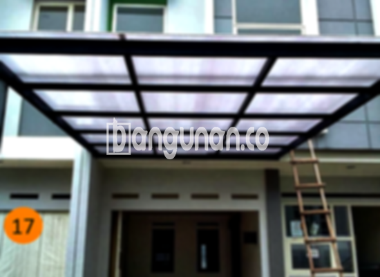

**Jasa Pasang Kanopi Rumah Minimalis di Panaragan Bogor** – Memiliki area luar rumah yang nyaman dan terlindungi adalah dambaan setiap pemilik rumah di Panaragan Bogor. Kanopi hadir sebagai solusi praktis untuk menjaga teras, garasi, atau carport dari sengatan matahari dan guyuran hujan. Mitra Bangunan memahami pentingnya perlindungan optimal bagi hunian Anda, dan kami siap mewujudkannya dengan layanan pemasangan kanopi berkualitas.

Kanopi bukan hanya berfungsi sebagai pelindung, tetapi juga mempercantik tampilan fasad rumah Anda. Tersedia beragam material yang dapat dipilih, mulai dari baja ringan yang ekonomis hingga kaca yang elegan. Pilihan ada di tangan Anda, dan kami siap membantu mewujudkan desain kanopi impian Anda di Panaragan Bogor.



## Harga Kanopi Rumah Minimalis di Panaragan Bogor

Mempertimbangkan anggaran adalah hal penting sebelum memutuskan untuk memasang kanopi. Anda mungkin bertanya-tanya, berapa biaya yang dibutuhkan untuk mendapatkan kanopi berkualitas di Panaragan Bogor? Sebelum membuat keputusan, penting untuk memahami beberapa faktor yang memengaruhi harga kanopi rumah.

Harga kanopi tidak bersifat baku dan bisa bervariasi tergantung pada beberapa aspek berikut:

### \- Pemilihan Material oleh Jasa Pasang Kanopi Rumah Minimalis di Panaragan Bogor

Material yang digunakan merupakan salah satu faktor utama penentu harga. Kami menawarkan berbagai pilihan material, termasuk besi, baja ringan, dan polycarbonate. Setiap material memiliki karakteristik dan harga yang berbeda, memungkinkan Anda memilih yang paling sesuai dengan kebutuhan dan anggaran Anda.

### \- Desain dan Model Kanopi dari Jasa Pasang Kanopi Rumah Minimalis di Panaragan Bogor

Desain kanopi yang Anda pilih juga memengaruhi harga. Model yang lebih kompleks atau membutuhkan proses fabrikasi khusus tentu akan memiliki biaya yang lebih tinggi. Kami menyediakan beragam model kanopi, mulai dari yang sederhana hingga yang lebih artistik, untuk memenuhi selera Anda.

### \- Luas Area yang Akan Ditutupi Kanopi

Ukuran kanopi yang Anda butuhkan juga berpengaruh pada harga akhir. Semakin luas area yang perlu ditutupi, semakin banyak material yang dibutuhkan, dan semakin tinggi biayanya. Untuk mendapatkan estimasi yang akurat, kami sarankan Anda melakukan pengukuran area terlebih dahulu.

Untuk informasi lebih detail mengenai harga kanopi di Panaragan Bogor, silakan lihat tabel harga yang telah kami sediakan  atau hubungi tim kami untuk konsultasi gratis.

## Pilihan Ragam Kanopi Rumah Minimalis di Panaragan Bogor

Kami menawarkan berbagai pilihan material kanopi untuk memenuhi kebutuhan dan preferensi Anda. Setiap material memiliki keunggulan dan kekurangan masing-masing. Berikut adalah beberapa opsi populer yang bisa Anda pertimbangkan:

### \- Kanopi Baja Ringan: Kekuatan dan Efisiensi

Baja ringan merupakan pilihan yang populer karena menawarkan kombinasi antara kekuatan dan harga yang terjangkau. Material ini ringan namun kokoh, tahan terhadap karat, dan mudah dipasang.

Kanopi baja ringan memiliki keawetan yang cukup baik, bahkan mampu bertahan selama bertahun-tahun dengan perawatan yang tepat. Selain itu, baja ringan juga tersedia dalam berbagai pilihan warna dan desain, memungkinkan Anda mendapatkan kanopi yang sesuai dengan gaya arsitektur rumah Anda.

### \- Kanopi Polycarbonate: Estetika dan Fungsionalitas

Polycarbonate adalah material plastik yang kuat dan tahan benturan. Kanopi polycarbonate memiliki beberapa keunggulan, antara lain:

*   **Tahan terhadap cuaca ekstrem:** Polycarbonate tidak mudah retak atau pecah akibat paparan sinar matahari, hujan, atau angin kencang.
*   **Transparan atau semi-transparan:** Polycarbonate memungkinkan cahaya alami masuk ke dalam rumah, menciptakan suasana yang lebih terang dan nyaman.
*   **Ringan dan mudah dipasang:** Polycarbonate lebih ringan daripada kaca, sehingga memudahkan proses pemasangan.

### \- Kanopi Kaca: Elegansi dan Kemewahan

Jika Anda menginginkan tampilan yang mewah dan elegan, kanopi kaca bisa menjadi pilihan yang tepat. Kaca memberikan kesan modern dan bersih, serta memungkinkan cahaya alami masuk ke dalam rumah secara maksimal. Namun, perlu diingat bahwa kanopi kaca membutuhkan perawatan yang lebih intensif dan mungkin lebih rentan terhadap kerusakan.

Kami akan membantu Anda memilih material kanopi yang paling sesuai dengan kebutuhan dan anggaran Anda di Panaragan Bogor.

**Ref by:**  [Kanopi Rumah Minimalis Panaragan Bogor](https://id.wikipedia.org/wiki/Kanopi)

Mitra Bangunan siap menjadi solusi terbaik untuk kebutuhan pemasangan kanopi rumah minimalis Anda di Panaragan Bogor. Hubungi kami sekarang melalui tombol WhatsApp atau Telepon yang tersedia di halaman ini untuk mendapatkan penawaran menarik dan konsultasi gratis! Jangan ragu untuk berkonsultasi dengan tim profesional kami untuk mendapatkan kanopi yang ideal untuk rumah Anda.