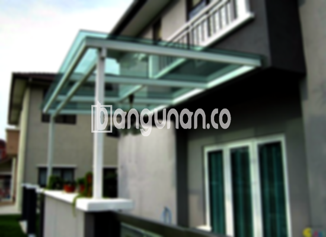

**Jasa Pasang Kanopi Rumah Minimalis di Pancoran Mas Depok** – Memiliki area luar rumah yang nyaman dan terlindungi adalah dambaan setiap warga Pancoran Mas Depok. Kanopi hadir sebagai solusi praktis untuk menjaga teras, garasi, atau area terbuka lainnya dari panas matahari dan hujan. Mitra Bangunan menyediakan layanan pemasangan kanopi berkualitas dengan harga terjangkau, memastikan kenyamanan maksimal bagi keluarga Anda.

Kanopi menawarkan berbagai manfaat bagi hunian Anda, tidak hanya melindungi dari cuaca ekstrem tetapi juga mempercantik tampilan fasad rumah. Dengan berbagai pilihan material dan desain, Anda dapat menemukan kanopi yang sesuai dengan gaya arsitektur dan kebutuhan spesifik Anda di Pancoran Mas Depok.



## Harga Kanopi Rumah Minimalis di Pancoran Mas Depok

Banyak warga Pancoran Mas Depok yang bertanya tentang perkiraan biaya pemasangan kanopi. Sebelum memutuskan, penting untuk memahami faktor-faktor yang memengaruhi harga kanopi rumah. Dengan memahami hal ini, Anda dapat membuat keputusan yang tepat dan memilih kanopi yang sesuai dengan anggaran Anda.

Beberapa faktor utama yang memengaruhi harga kanopi antara lain:

### \- Material yang Digunakan

Pemilihan material kanopi sangat memengaruhi harga. Material seperti besi, baja ringan, dan polycarbonate memiliki harga yang berbeda-beda. Setiap material memiliki kelebihan dan kekurangan masing-masing, jadi pertimbangkan kebutuhan dan anggaran Anda saat memilih material.

### \- Model Kanopi

Model kanopi juga memengaruhi harga. Kanopi sederhana biasanya lebih murah daripada kanopi dengan desain yang rumit. Pastikan Anda memilih model yang sesuai dengan gaya rumah Anda dan sesuai dengan anggaran.

### \- Ukuran Kanopi

Luas area yang akan ditutupi kanopi juga memengaruhi harga. Semakin luas area tersebut, semakin banyak material yang dibutuhkan, dan semakin tinggi biayanya.

Untuk informasi lebih detail mengenai harga, silakan lihat tabel harga yang telah kami sediakan  atau hubungi tim kami untuk mendapatkan penawaran harga khusus yang disesuaikan dengan kebutuhan Anda di Pancoran Mas Depok.

## Rekomendasi Jenis Kanopi Rumah Minimalis di Pancoran Mas Depok

**Ref by:**  [Kanopi Rumah Minimalis Pancoran Mas Depok](https://id.wikipedia.org/wiki/Kanopi)

Saat memilih kanopi untuk rumah Anda di Pancoran Mas Depok, ada beberapa jenis yang bisa Anda pertimbangkan. Salah satu pilihan populer adalah kanopi berbahan baja ringan yang menawarkan banyak keunggulan. Mari kita telaah lebih lanjut kelebihan kanopi baja ringan:

### \- Keawetan yang Terjamin

Salah satu pertimbangan utama saat memilih kanopi adalah keawetannya. Kanopi baja ringan dikenal dengan kualitasnya yang sangat baik dan tahan lama. Material ini mampu menahan cuaca ekstrem dan memberikan perlindungan jangka panjang untuk rumah Anda.

Banyak pengguna telah membuktikan kekokohan kanopi baja ringan, dengan beberapa bahkan bertahan selama puluhan tahun tanpa masalah berarti.

### \- Pilihan Model yang Beragam

Baja ringan memungkinkan pembuatan kanopi dengan berbagai model dan desain. Hal ini memberi Anda fleksibilitas untuk memilih kanopi yang sesuai dengan gaya arsitektur rumah Anda di Pancoran Mas Depok. Pilihan yang beragam ini tentu menjadi nilai tambah bagi banyak orang.

### \- Keamanan yang Optimal

Baja ringan adalah material yang kuat dan aman untuk digunakan sebagai kanopi. Struktur yang kokoh meminimalkan risiko kerusakan atau roboh akibat cuaca buruk. Dengan menggunakan kanopi baja ringan, Anda dapat merasa tenang dan aman.

Bagi Anda yang mencari kanopi yang tahan lama, aman, dan memiliki tampilan menarik, kanopi berbahan baja ringan adalah pilihan tepat. Tim Kami siap membantu Anda dalam proses perencanaan dan pemasangan kanopi yang sempurna untuk rumah Anda di Pancoran Mas Depok.

Mitra Bangunan siap membantu Anda mewujudkan kanopi impian di Pancoran Mas Depok. Hubungi kami sekarang melalui tombol WhatsApp atau Telepon yang tersedia di halaman ini untuk konsultasi gratis dan penawaran terbaik. Jangan ragu menghubungi kami untuk mendapatkan informasi lebih lanjut mengenai layanan jasa pasang kanopi rumah minimalis di Pancoran Mas Depok.