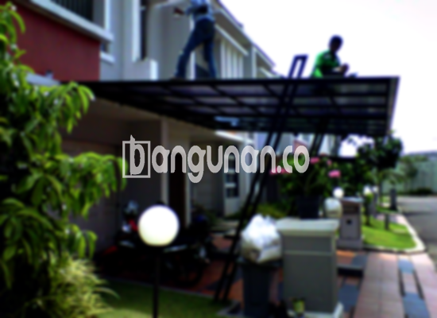

**Jasa Pasang Kanopi Rumah Minimalis di Pandeglang** – Mencari solusi perlindungan optimal untuk teras, garasi, atau area luar rumah Anda di Pandeglang? Kanopi adalah investasi cerdas yang memberikan kenyamanan dan nilai estetika. Mitra Bangunan hadir sebagai penyedia jasa pembuatan dan pemasangan kanopi berkualitas dengan harga terjangkau, membantu Anda menciptakan ruang luar yang lebih fungsional dan menarik.

Kanopi hadir dalam beragam material, seperti galvalum dan besi hollo. Pemilihan material ini penting karena masing-masing menawarkan keunggulan dan kekurangan tersendiri yang sesuai dengan kebutuhan dan preferensi Anda.

Dengan memasang kanopi, Anda tidak hanya terhindar dari sengatan matahari dan hujan, tetapi juga meningkatkan fungsi dan nilai properti Anda secara keseluruhan. Kanopi menjadi pelengkap arsitektur yang memberikan kesan modern dan elegan pada rumah Anda.



## Harga Kanopi Rumah Minimalis di Pandeglang

Sebelum memutuskan untuk memesan kanopi untuk hunian Anda, penting untuk memahami perkiraan biaya yang diperlukan.  Anda dapat membandingkan berbagai opsi kanopi untuk menemukan yang paling sesuai dengan anggaran Anda.

Beberapa faktor utama memengaruhi harga kanopi, antara lain:

### - Material yang Digunakan oleh Jasa Pasang Kanopi Rumah Minimalis di Pandeglang

Pilihan material merupakan pertimbangan penting dalam menentukan harga kanopi. Material seperti besi, baja ringan, dan polycarbonate memiliki harga yang berbeda-beda.  Anda dapat memilih jenis material yang paling sesuai dengan kebutuhan dan anggaran Anda.

### - Model Kanopi dari Jasa Pasang Kanopi Rumah Minimalis di Pandeglang

Model kanopi juga mempengaruhi harga. Terdapat beragam pilihan desain dan gaya kanopi yang dapat Anda pilih. Semakin kompleks dan unik desainnya, umumnya semakin tinggi harganya.

### - Ukuran Kanopi

Ukuran area yang akan ditutupi oleh kanopi juga akan memengaruhi biaya. Kanopi yang lebih besar tentu membutuhkan lebih banyak material dan tenaga kerja, sehingga harganya akan lebih tinggi.

Apabila Anda sudah mempertimbangkan faktor-faktor tersebut, Anda akan dapat memperkirakan biaya yang dibutuhkan. Kualitas yang lebih baik umumnya akan sebanding dengan harga yang lebih tinggi. Untuk informasi harga yang lebih detail, silakan lihat tabel harga  atau hubungi tim kami.

## Rekomendasi Macam Kanopi Rumah Minimalis di Pandeglang

**Ref by:**  [Kanopi Rumah Minimalis Pandeglang](https://id.wikipedia.org/wiki/Kanopi)

Bagi Anda yang berencana memasang kanopi untuk rumah, ruko, atau bangunan lainnya, terdapat beragam jenis kanopi yang bisa Anda pertimbangkan. Salah satu pilihan yang populer adalah kanopi berbahan baja ringan. Jenis kanopi ini menawarkan sejumlah keunggulan dibandingkan material lainnya.

### - Kekuatan dan Daya Tahan Utama

Hal terpenting saat memilih kanopi adalah kekuatan dan daya tahannya. Kanopi yang terbuat dari baja ringan dikenal memiliki kualitas yang sangat baik. Kekuatannya terjamin dan tahan lama sehingga Anda tidak perlu khawatir akan kerusakan atau penggantian dalam waktu dekat. 

Banyak pengguna melaporkan bahwa kanopi baja ringan dapat bertahan selama bertahun-tahun tanpa mengalami penurunan kualitas yang signifikan.

### - Pilihan Model yang Beragam dari Jasa Pasang Kanopi Rumah Minimalis di Pandeglang

Bagi Anda yang ingin menambahkan nilai estetika pada bangunan Anda, kanopi baja ringan menawarkan berbagai pilihan model yang menarik. Anda dapat menyesuaikan desain kanopi sesuai dengan gaya arsitektur bangunan Anda.

### - Tingkat Keamanan yang Tinggi dari Jasa Pasang Kanopi Rumah Minimalis di Pandeglang

Baja ringan merupakan material yang memiliki tingkat kekuatan yang tinggi. Hal ini menjamin keamanan pengguna karena kanopi lebih tahan terhadap benturan dan tekanan eksternal. Anda dapat merasa tenang karena kanopi baja ringan memberikan perlindungan maksimal.

Untuk Anda yang mencari solusi kanopi yang kuat, tahan lama, dan estetis, kanopi berbahan baja ringan merupakan pilihan tepat.

Mitra Bangunan menyediakan berbagai jenis kanopi minimalis di Pandeglang, termasuk kanopi baja ringan, galvalum, kaca, dan polycarbonate.  Hubungi kami melalui tombol WhatsApp atau Telepon di halaman ini untuk konsultasi gratis dan penawaran terbaik. Kami siap membantu Anda mewujudkan hunian yang nyaman dan terlindungi.

