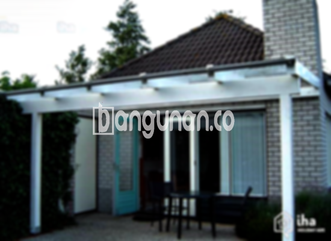

**Jasa Pasang Kanopi Rumah Minimalis di Pangkalan Jati Depok** – Memiliki area outdoor yang nyaman dan terlindungi adalah dambaan setiap pemilik rumah di Pangkalan Jati Depok. Kanopi hadir sebagai solusi praktis untuk melindungi teras, garasi, atau area lainnya dari panas matahari dan hujan. Mitra Bangunan hadir untuk membantu Anda mewujudkan kenyamanan tersebut dengan layanan pemasangan kanopi berkualitas dan terjangkau.

Kanopi bukan sekadar pelindung cuaca; ia juga berperan penting dalam meningkatkan estetika bangunan Anda. Dengan berbagai pilihan material dan desain, Anda dapat menemukan kanopi yang sempurna untuk melengkapi gaya rumah minimalis Anda. 



## Harga Kanopi Rumah Minimalis di Pangkalan Jati Depok

Mendapatkan informasi harga yang jelas sebelum memesan kanopi adalah langkah bijak. Harga kanopi rumah di Pangkalan Jati Depok bervariasi, tergantung pada beberapa faktor penting yang perlu Anda pertimbangkan. Anda dapat membandingkan berbagai pilihan agar menemukan solusi yang paling sesuai dengan anggaran dan kebutuhan Anda.

Berikut adalah beberapa faktor utama yang memengaruhi harga kanopi:

### \- Material yang Digunakan

Pemilihan material merupakan faktor krusial dalam menentukan harga kanopi. Ada berbagai pilihan material yang tersedia, seperti baja ringan, besi hollo, kaca, dan polycarbonate. Setiap material memiliki karakteristik dan harga yang berbeda. Anda dapat memilih material yang paling sesuai dengan preferensi estetika dan anggaran Anda.

### \- Model Kanopi

Desain dan model kanopi juga memengaruhi harganya. Ada berbagai pilihan model kanopi yang tersedia, mulai dari model sederhana hingga yang lebih kompleks. Anda dapat memilih model yang sesuai dengan gaya arsitektur rumah Anda dan kebutuhan fungsional Anda.

### \- Ukuran Kanopi

Ukuran kanopi adalah faktor penting lainnya yang memengaruhi harganya. Semakin besar ukuran kanopi, semakin banyak material yang dibutuhkan, dan semakin tinggi biayanya. Penting untuk mengukur area yang akan ditutup kanopi dengan tepat sebelum melakukan pemesanan.

Untuk mendapatkan penawaran harga terbaik, kami sarankan Anda untuk menghubungi tim profesional kami. Kami akan memberikan estimasi harga yang akurat dan transparan berdasarkan kebutuhan spesifik Anda.

## Rekomendasi Ragam Kanopi Rumah Minimalis di Pangkalan Jati Depok



Ketika Anda berencana memasang kanopi untuk rumah di Pangkalan Jati Depok, penting untuk mempertimbangkan berbagai jenis material yang tersedia. Salah satu pilihan yang sangat direkomendasikan adalah kanopi berbahan baja ringan. Material ini menawarkan sejumlah keunggulan dibandingkan dengan material lainnya.

### \- Kekuatan dan Ketahanan

Kekuatan adalah aspek penting yang perlu diperhatikan saat memilih kanopi. Kanopi berbahan baja ringan dikenal karena ketahanannya terhadap cuaca ekstrem dan benturan. Baja ringan memiliki kemampuan untuk menahan beban berat dan tidak mudah rusak.

### \- Variasi Desain

Selain kuat, kanopi baja ringan juga menawarkan fleksibilitas desain yang tinggi. Anda dapat memilih dari berbagai model dan desain yang tersedia, atau bahkan menyesuaikan desain sesuai dengan preferensi Anda. Keunggulan ini memungkinkan Anda menciptakan kanopi yang unik dan sesuai dengan gaya rumah Anda.

### \- Keamanan Terjamin

Keamanan merupakan prioritas utama dalam memilih kanopi. Baja ringan adalah material yang aman dan tidak mudah terbakar. Dengan menggunakan kanopi baja ringan, Anda dapat memastikan keamanan rumah dan keluarga Anda.

Kami menyediakan berbagai pilihan kanopi baja ringan dengan desain dan ukuran yang beragam. Tim ahli kami akan membantu Anda memilih kanopi yang paling sesuai dengan kebutuhan dan anggaran Anda.

**Ref by:**  [Kanopi Rumah Minimalis Pangkalan Jati Depok](https://id.wikipedia.org/wiki/Kanopi)

Dengan solusi kanopi yang tepat, Anda dapat menikmati area outdoor rumah Anda sepanjang tahun tanpa khawatir dengan cuaca. Mitra Bangunan siap membantu Anda mewujudkan impian tersebut. Jangan ragu untuk menghubungi kami melalui tombol WhatsApp atau Telepon di halaman ini untuk konsultasi gratis dan penawaran terbaik untuk jasa pasang kanopi rumah minimalis di Pangkalan Jati Depok.