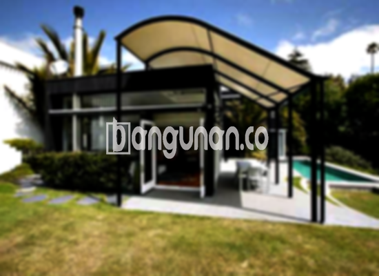

**Jasa Pasang Kanopi Rumah Minimalis di Papanggo Jakarta** – Menciptakan ruang luar yang nyaman dan terlindungi adalah prioritas utama bagi banyak pemilik rumah di Papanggo Jakarta. Apakah Anda sedang mempertimbangkan pemasangan kanopi untuk teras, garasi, atau area lainnya? Kami hadir sebagai solusi terpercaya bagi Mitra Bangunan yang menginginkan kanopi berkualitas dengan harga terjangkau.

Kanopi bukan sekadar pelindung dari cuaca ekstrem; ia juga mempercantik tampilan fasad rumah Anda. Ada berbagai jenis kanopi yang tersedia, mulai dari baja ringan yang ekonomis hingga kaca yang elegan. Memilih jenis yang tepat bergantung pada kebutuhan estetika dan fungsional Anda.



## Harga Kanopi Rumah Minimalis di Papanggo Jakarta

Sebelum memutuskan untuk memesan kanopi, penting bagi Anda untuk memahami faktor-faktor yang memengaruhi harganya. Harga kanopi dapat bervariasi tergantung pada beberapa aspek penting. Memahami lebih dulu akan membantu Anda membuat keputusan yang tepat untuk anggaran Anda.

Berikut adalah beberapa faktor utama yang memengaruhi harga kanopi:

### \- Jenis Material yang Digunakan

Material merupakan faktor penentu harga utama. Material seperti besi, baja ringan, atau kaca memiliki harga yang berbeda-beda. Setiap material menawarkan keunggulan dan kekurangan tersendiri dalam hal kekuatan, estetika, dan biaya.

### \- Model dan Desain Kanopi

Model dan desain kanopi yang Anda pilih juga akan memengaruhi harganya. Desain yang lebih rumit atau khusus biasanya akan lebih mahal daripada desain yang sederhana. Pilihlah model yang sesuai dengan gaya arsitektur rumah dan kebutuhan Anda.

### \- Ukuran Kanopi

Ukuran kanopi, yakni panjang dan lebarnya, secara langsung memengaruhi harga. Semakin besar ukuran kanopi, semakin banyak material yang dibutuhkan, sehingga biayanya pun meningkat. Ukur area yang akan ditutupi dengan tepat sebelum memesan.

Dengan mempertimbangkan faktor-faktor di atas, Anda dapat memperkirakan anggaran yang dibutuhkan untuk pemasangan kanopi di rumah Anda di Papanggo Jakarta. Untuk mendapatkan penawaran harga yang akurat, Anda dapat menghubungi kami untuk konsultasi gratis.

## Rekomendasi Ragam Kanopi Rumah Minimalis di Papanggo Jakarta



Jika Anda sedang mencari pilihan kanopi terbaik untuk rumah Anda, ada beberapa jenis yang sangat direkomendasikan. Salah satunya adalah kanopi berbahan baja ringan, yang menawarkan kombinasi ideal antara kekuatan, harga terjangkau, dan kemudahan pemasangan.

Berikut adalah beberapa keunggulan utama kanopi baja ringan:

### \- Daya Tahan yang Unggul

Salah satu pertimbangan utama saat memilih kanopi adalah daya tahannya. Baja ringan adalah material yang sangat kuat dan tahan lama, mampu menahan berbagai kondisi cuaca ekstrem. Anda dapat mengandalkan kanopi baja ringan untuk melindungi rumah Anda selama bertahun-tahun.

### \- Pilihan Desain yang Beragam

Kanopi baja ringan hadir dalam berbagai desain dan gaya, memungkinkan Anda untuk memilih yang paling sesuai dengan estetika rumah Anda. Baik Anda menginginkan model minimalis, modern, maupun klasik, Anda akan menemukan pilihan yang tepat.

### \- Keamanan Terjamin

Keamanan adalah prioritas utama. Baja ringan memiliki tingkat kekuatan yang tinggi, sehingga meminimalkan risiko kerusakan atau roboh akibat angin kencang atau beban berat. Anda dapat merasa tenang mengetahui bahwa kanopi baja ringan melindungi Anda dan keluarga.

Bagi Anda yang mencari solusi kanopi yang handal dan terjangkau di Papanggo Jakarta, kanopi baja ringan adalah pilihan yang sangat tepat. Kami menawarkan berbagai pilihan kanopi baja ringan berkualitas tinggi dengan harga yang kompetitif.

Dengan berbagai pilihan material dan desain yang tersedia, Kami siap membantu Anda menemukan kanopi yang sempurna untuk rumah Anda di Papanggo Jakarta. Jangan ragu untuk menghubungi Kami melalui tombol WhatsApp atau Telepon yang ada di halaman ini untuk konsultasi, penawaran harga, dan pemesanan. Mitra Bangunan akan mendapatkan solusi terbaik untuk kebutuhan kanopi Anda.

**Ref by:**  [Kanopi Rumah Minimalis Papanggo Jakarta](https://id.wikipedia.org/wiki/Kanopi)