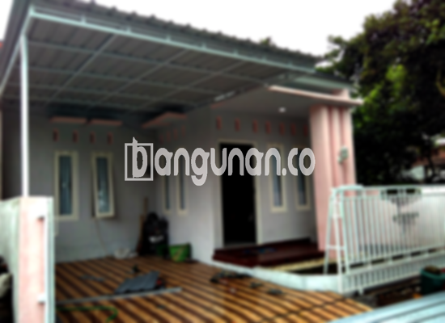

**Jasa Pasang Kanopi Rumah Minimalis di Parung Panjang** – Mencari solusi untuk melindungi teras atau carport dari terik matahari dan hujan deras di Parung Panjang? Kanopi adalah jawaban yang tepat. Sebagai Mitra Bangunan, Anda tentu menginginkan kenyamanan dan keamanan hunian yang optimal. Kami hadir sebagai penyedia jasa pembuatan dan pemasangan kanopi berkualitas dengan harga terjangkau.

Kanopi hadir dalam berbagai material, seperti baja ringan dan besi hollo. Setiap jenis material memiliki karakteristik dan keunggulan tersendiri yang dapat disesuaikan dengan kebutuhan dan anggaran Anda. Memilih kanopi yang tepat akan mempercantik tampilan rumah sekaligus memberikan perlindungan maksimal.

Selain fungsi utamanya sebagai pelindung, kanopi juga berperan penting dalam meningkatkan estetika bangunan. Dengan desain yang tepat, kanopi dapat menjadi elemen dekoratif yang mempercantik fasad rumah Anda.



## Harga Kanopi Rumah Minimalis di Parung Panjang

Pertimbangan harga adalah hal wajar sebelum memutuskan untuk memasang kanopi. Agar perencanaan anggaran Anda lebih efektif, sebaiknya Anda memahami faktor-faktor yang memengaruhi harga kanopi rumah di Parung Panjang. Dengan begitu, Anda dapat memilih kanopi yang sesuai dengan kebutuhan dan anggaran yang tersedia.

Berikut beberapa faktor yang memengaruhi harga layanan jasa pasang kanopi rumah minimalis di Parung Panjang:

### – Jenis Material yang Digunakan

Pilihan material kanopi akan sangat memengaruhi harga. Material populer seperti besi dan baja ringan memiliki harga yang berbeda. Pertimbangkan kelebihan dan kekurangan masing-masing material sebelum membuat keputusan.

### – Model dan Desain Kanopi

Desain kanopi, baik yang sederhana maupun kompleks, juga memengaruhi biaya pemasangan. Model yang lebih rumit tentu akan membutuhkan proses pembuatan dan pemasangan yang lebih lama dan detail.

### – Ukuran Kanopi

Luas area yang akan ditutupi kanopi (panjang dan lebar) adalah faktor penentu utama. Semakin luas area yang akan ditutupi, semakin banyak material yang dibutuhkan, dan semakin tinggi pula biayanya.

Untuk informasi lebih detail tentang harga, Anda dapat melihat tabel harga yang tersedia  atau menghubungi tim kami untuk mendapatkan penawaran khusus.

## Rekomendasi Jenis Kanopi Rumah Minimalis di Parung Panjang

**Ref by:**  [Kanopi Rumah Minimalis Parung Panjang](https://id.wikipedia.org/wiki/Kanopi)

Ada banyak sekali pilihan jenis kanopi yang tersedia. Salah satu rekomendasi kami adalah kanopi berbahan baja ringan. Material ini menawarkan berbagai keunggulan yang menjadikannya pilihan populer bagi banyak orang. Berikut adalah beberapa kelebihannya:

### – Kekuatan dan Ketahanan Tinggi

Keawetan merupakan faktor penting dalam memilih kanopi. Kanopi berbahan baja ringan dikenal memiliki kualitas yang sangat baik dan tahan lama. Anda dapat menikmati perlindungan optimal selama bertahun-tahun tanpa khawatir akan kerusakan.

### – Fleksibilitas Desain

Kanopi baja ringan menawarkan keunggulan dalam hal desain. Anda dapat memilih berbagai model dan bentuk sesuai dengan selera dan gaya arsitektur rumah Anda. Fleksibilitas ini memungkinkan Anda menciptakan kanopi yang unik dan sesuai dengan karakter hunian Anda.

### – Keamanan Terjamin

Baja ringan adalah material yang kokoh dan aman. Pemasangan kanopi baja ringan yang tepat akan memberikan ketenangan pikiran karena Anda tidak perlu khawatir akan risiko kerusakan atau roboh akibat cuaca buruk.

Bagi Anda yang membutuhkan kanopi untuk garasi, teras, atau area komersial di Parung Panjang, kanopi berbahan baja ringan adalah pilihan yang sangat tepat. Dengan berbagai keunggulan yang ditawarkannya, Anda akan mendapatkan solusi perlindungan yang optimal dan estetis. 

Semoga informasi ini bermanfaat bagi Anda. Sebagai Mitra Bangunan di Parung Panjang, jangan ragu untuk menghubungi kami melalui tombol WhatsApp atau Telepon yang tersedia di halaman ini untuk konsultasi gratis dan penawaran terbaik. Kami siap membantu Anda mewujudkan kanopi impian Anda!