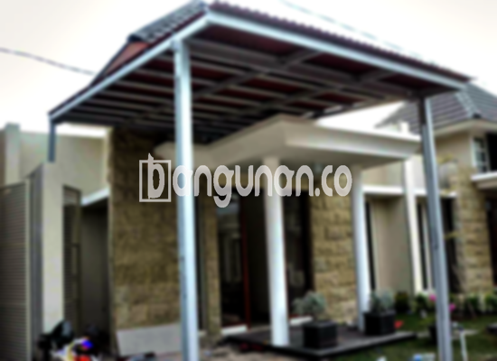

**Jasa Pasang Kanopi Rumah Minimalis di Pasar Baru Jakarta** – Memiliki area luar ruangan yang nyaman dan terlindungi adalah impian setiap pemilik rumah. Mitra Bangunan di Pasar Baru Jakarta tidak perlu lagi kesulitan mencari solusi terbaik untuk melindungi teras, garasi, atau carport. Kami hadir sebagai penyedia jasa pemasangan kanopi berkualitas dengan harga terjangkau, memberikan kenyamanan dan estetika pada hunian Anda.

Kanopi hadir sebagai solusi praktis untuk melindungi bangunan dari cuaca ekstrem. Lebih dari sekadar fungsi praktis, kanopi juga meningkatkan tampilan visual rumah dan memberikan nilai tambah pada properti Anda. Dengan berbagai pilihan material dan desain, Anda dapat menemukan kanopi yang sempurna untuk melengkapi gaya arsitektur rumah Anda di Pasar Baru Jakarta.



## Harga Kanopi Rumah Minimalis di Pasar Baru Jakarta

Apakah Anda sedang merencanakan pemasangan kanopi untuk rumah di Pasar Baru Jakarta? Memahami kisaran harga akan membantu Anda dalam membuat keputusan yang tepat. Anda dapat mengeksplorasi berbagai pilihan dan menyesuaikan anggaran dengan kebutuhan dan preferensi Anda. Kami menyediakan layanan konsultasi gratis untuk membantu Anda menentukan solusi kanopi yang paling sesuai.

Harga kanopi dipengaruhi oleh beberapa faktor penting yang perlu Anda pertimbangkan:

### – Material Kanopi yang Digunakan

Pemilihan material kanopi memainkan peran krusial dalam menentukan harga akhir. Kami menyediakan beragam pilihan material seperti baja ringan, galvalum, kaca, dan polycarbonate, masing-masing dengan karakteristik dan rentang harga yang berbeda.  Anda dapat menyesuaikan pilihan material berdasarkan kebutuhan estetika, anggaran, dan kekuatan yang Anda inginkan.

### – Desain dan Model Kanopi

Desain dan model kanopi yang Anda pilih akan memengaruhi kompleksitas pekerjaan dan biaya yang dikeluarkan. Kami menawarkan berbagai pilihan desain minimalis, modern, dan klasik untuk memenuhi selera Anda. Semakin kompleks desainnya, semakin detail pengerjaan yang dibutuhkan, dan potensi pengaruhnya pada harga.

### – Ukuran Area Pemasangan

Luas area yang akan ditutupi kanopi juga menjadi faktor penentu harga. Semakin besar area yang perlu dipasang kanopi, semakin banyak material yang dibutuhkan, dan semakin lama waktu pengerjaan yang diperlukan. Kami menyediakan layanan pengukuran presisi untuk memastikan perkiraan harga yang akurat.

Informasi lebih detail mengenai harga dan penawaran khusus dapat Anda temukan pada tabel harga atau dengan menghubungi tim kami untuk konsultasi personal.

## Rekomendasi Ragam Kanopi Rumah Minimalis di Pasar Baru Jakarta



Terdapat berbagai jenis kanopi yang dapat Anda pertimbangkan untuk rumah di Pasar Baru Jakarta. Salah satu pilihan yang paling populer adalah kanopi berbahan baja ringan yang menawarkan kombinasi kekuatan, ketahanan, dan harga yang kompetitif. Berikut adalah beberapa keunggulan yang ditawarkan oleh kanopi baja ringan:

### – Keawetan dan Kekuatan Optimal

Kanopi berbahan galvalum dikenal dengan keawetannya yang luar biasa. Material ini tahan terhadap korosi dan cuaca ekstrem, sehingga menjamin umur pakai yang panjang dan perawatan minimal. Kekuatan material ini juga memungkinkan kanopi untuk menahan beban angin kencang dan hujan deras.

### – Variasi Desain yang Luas

Kanopi baja ringan menawarkan fleksibilitas desain yang tinggi. Anda dapat memilih dari berbagai model dan desain yang tersedia, atau bahkan membuat desain kustom sesuai dengan preferensi Anda. Kemampuan beradaptasi ini menjadikan kanopi baja ringan sebagai pilihan ideal untuk berbagai gaya arsitektur rumah.

### – Keamanan Terjamin

Baja ringan merupakan material yang kuat dan stabil, sehingga memberikan perlindungan maksimal bagi Anda dan keluarga. Kanopi berbahan galvalum dirancang untuk menahan beban dan memberikan keamanan yang optimal, mengurangi risiko kerusakan akibat cuaca buruk atau kejadian tak terduga lainnya.

Dengan mempertimbangkan keunggulan-keunggulan tersebut, kanopi berbahan baja ringan menjadi pilihan yang cerdas dan ekonomis untuk melindungi rumah Anda di Pasar Baru Jakarta. 

Semoga informasi tentang jasa pasang kanopi rumah minimalis di Pasar Baru Jakarta ini bermanfaat bagi Anda. Mitra Bangunan siap membantu Anda mewujudkan hunian yang nyaman dan terlindungi. Jangan ragu untuk menghubungi kami melalui tombol WhatsApp atau Telepon di halaman ini untuk mendapatkan penawaran terbaik dan layanan pemasangan profesional.

**Ref by:**  [Kanopi Rumah Minimalis Pasar Baru Jakarta](https://id.wikipedia.org/wiki/Kanopi)