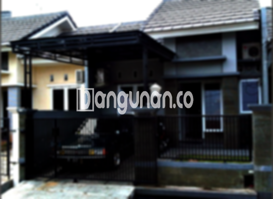

**Jasa Pasang Kanopi Rumah Minimalis di Pasar Minggu Jakarta** – Memiliki area luar ruangan yang nyaman dan terlindungi adalah dambaan setiap pemilik rumah di Pasar Minggu Jakarta. Kanopi adalah solusi tepat untuk melindungi teras, garasi, atau area lainnya dari cuaca ekstrem. Mitra Bangunan hadir sebagai penyedia jasa pembuatan dan pemasangan kanopi yang terpercaya dan terjangkau untuk kebutuhan Anda.

Kanopi hadir dalam beragam material, seperti baja ringan dan besi hollo. Pemilihan material yang tepat akan sangat mempengaruhi tampilan dan fungsionalitas kanopi Anda. Ragam model juga tersedia, memungkinkan Anda menyesuaikan desain dengan gaya arsitektur rumah.

Bagi Anda yang ingin memasang kanopi di rumah, ada banyak manfaat yang bisa diperoleh. Tidak hanya melindungi dari panas matahari dan hujan, kanopi juga dapat meningkatkan estetika rumah dan memberikan nilai tambah pada properti Anda.



## Harga Kanopi Rumah Minimalis di Pasar Minggu Jakarta

Apakah Anda berencana untuk memasang kanopi di kediaman Anda di Pasar Minggu Jakarta? Sebelum membuat keputusan, penting untuk memahami perkiraan biaya yang diperlukan. Dengan mengetahui harga kanopi rumah, Anda dapat merencanakan anggaran dengan lebih baik dan memilih opsi yang sesuai dengan kebutuhan dan kemampuan finansial Anda. Kami menyediakan informasi harga yang transparan dan kompetitif.

Harga kanopi dapat bervariasi berdasarkan beberapa faktor penting, di antaranya:

### - Bahan yang Digunakan oleh Jasa Pasang Kanopi Rumah Minimalis di Pasar Minggu Jakarta

Material menjadi pertimbangan utama dalam menentukan harga kanopi. Pilihan material yang umum digunakan termasuk besi, baja ringan, dan lainnya. Setiap material memiliki karakteristik dan harga yang berbeda. Anda dapat memilih material yang paling sesuai dengan preferensi dan anggaran Anda.

### - Model Kanopi dari Jasa Pasang Kanopi Rumah Minimalis di Pasar Minggu Jakarta

Model kanopi juga berperan penting dalam menentukan harga. Tersedia beragam model kanopi untuk dipilih, mulai dari yang sederhana hingga yang lebih kompleks. Pemilihan model yang tepat akan mempercantik tampilan rumah Anda dan meningkatkan nilai estetika.

### - Ukuran Kanopi

Ukuran kanopi, yaitu panjang dan lebar, juga mempengaruhi harga. Semakin besar ukuran kanopi, semakin banyak material yang dibutuhkan, dan semakin tinggi biayanya. Pastikan Anda mengukur area yang akan ditutupi kanopi dengan tepat sebelum melakukan pemesanan.

Dengan mempertimbangkan faktor-faktor tersebut, Anda dapat memperkirakan biaya pemasangan kanopi dan menemukan solusi yang paling sesuai dengan kebutuhan Anda. Jangan ragu untuk berkonsultasi dengan tim kami untuk mendapatkan penawaran harga yang akurat.

## Rekomendasi Ragam Kanopi Rumah Minimalis di Pasar Minggu Jakarta



Kami menawarkan berbagai pilihan kanopi rumah minimalis untuk Anda di Pasar Minggu Jakarta. Salah satu yang paling populer adalah kanopi berbahan baja ringan. Material ini menawarkan keunggulan tersendiri dibandingkan bahan lainnya. Berikut beberapa keunggulan kanopi baja ringan:

### - Kekuatan dan Ketahanan Prima

Ketahanan merupakan faktor penting yang perlu dipertimbangkan saat memilih kanopi. Kanopi yang terbuat dari baja ringan dikenal akan kualitasnya yang sangat baik dan daya tahannya yang tinggi. Anda dapat mengandalkan kanopi ini untuk memberikan perlindungan jangka panjang bagi properti Anda.

Kanopi baja ringan telah terbukti mampu bertahan selama bertahun-tahun tanpa kehilangan kekuatannya. Ini menjadikannya pilihan yang tepat bagi Anda yang mencari solusi yang awet dan tahan lama.

### - Pilihan Model yang Beragam dari Jasa Pasang Kanopi Rumah Minimalis di Pasar Minggu Jakarta

Kami menyediakan beragam model kanopi baja ringan untuk memenuhi selera dan kebutuhan Anda. Anda dapat memilih desain yang sesuai dengan gaya arsitektur rumah Anda. Fleksibilitas ini memungkinkan Anda menciptakan tampilan yang unik dan personal.

### - Tingkat Keamanan yang Terjamin dari Jasa Pasang Kanopi Rumah Minimalis di Pasar Minggu Jakarta

Baja ringan adalah material dengan tingkat kekokohan yang tinggi, sehingga memberikan keamanan yang optimal. Anda dapat merasa tenang karena kanopi baja ringan mampu menahan berbagai kondisi cuaca ekstrem. Risiko kerusakan atau roboh dapat diminimalkan secara signifikan.

Bagi Anda yang menginginkan kanopi untuk bangunan komersial, kanopi berbahan galvalum juga merupakan pilihan yang sangat baik. Material ini menawarkan berbagai keunggulan yang dapat memenuhi kebutuhan Anda.

**Ref by:**  [Kanopi Rumah Minimalis Pasar Minggu Jakarta](https://id.wikipedia.org/wiki/Kanopi)

Demikian informasi mengenai jasa pasang kanopi rumah minimalis di Pasar Minggu Jakarta yang dapat kami sampaikan. Untuk pemesanan atau konsultasi lebih lanjut, silakan hubungi kami melalui tombol WhatsApp atau Telepon yang tersedia di halaman ini. Kami akan dengan senang hati membantu Mitra Bangunan dalam mewujudkan kanopi impian Anda.