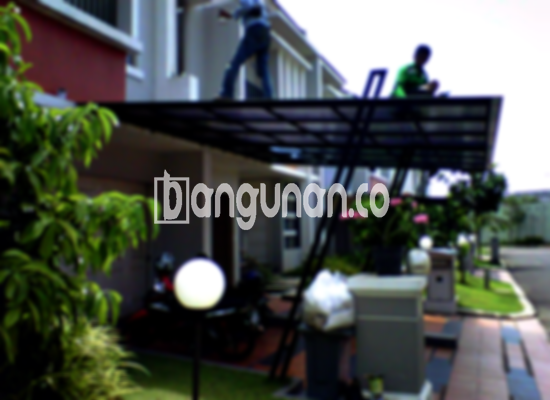

**Jasa Pasang Kanopi Rumah Minimalis di Pebayuran Bekasi** – Apakah Anda tengah mencari solusi terbaik untuk melindungi area teras, carport, atau halaman rumah Anda di Pebayuran Bekasi? Kanopi menawarkan perlindungan efektif dari cuaca panas dan hujan, sekaligus menambah nilai estetika pada bangunan Anda. Mitra Bangunan hadir sebagai penyedia jasa pemasangan kanopi berkualitas, terjangkau, dan terpercaya di wilayah Pebayuran Bekasi, siap membantu mewujudkan hunian yang nyaman dan aman.

Kanopi tersedia dalam berbagai material, seperti galvalum dan besi hollo, masing-masing dengan kelebihan dan kekurangan yang perlu Anda pertimbangkan sesuai dengan kebutuhan dan preferensi Anda. Pemilihan material yang tepat akan berdampak signifikan pada kekuatan, durabilitas, dan tampilan visual kanopi Anda.

Investasi pada kanopi memberikan manfaat yang tak ternilai bagi rumah Anda, mulai dari perlindungan terhadap unsur-unsur alam hingga peningkatan nilai properti dan kenyamanan ruang luar.

## Estimasi Biaya Kanopi Rumah Minimalis di Pebayuran Bekasi

Apakah Anda berencana untuk mempercantik dan melindungi rumah Anda dengan kanopi baru? Sebelum memutuskan, memahami perkiraan biaya pemasangan kanopi menjadi langkah yang sangat bijaksana. Pengetahuan ini akan membantu Anda dalam merencanakan anggaran secara efektif dan memilih opsi yang paling sesuai dengan kapasitas finansial Anda.

Terdapat beberapa faktor utama yang memengaruhi biaya pembuatan kanopi, antara lain:

### – Jenis Material yang Digunakan oleh Jasa Pasang Kanopi Rumah Minimalis di Pebayuran Bekasi

Material merupakan salah satu aspek terpenting dalam menentukan harga kanopi. Pilihan material seperti besi, baja ringan, polycarbonate, dan kaca memiliki harga yang berbeda-beda. Anda dapat memilih material yang paling sesuai dengan anggaran, gaya desain, dan kebutuhan fungsional Anda.

### – Model dan Desain Kanopi

Model dan desain kanopi juga berperan penting dalam menentukan harga akhir. Semakin rumit dan detail desainnya, semakin besar biaya yang akan dikeluarkan. Anda dapat memilih dari beragam model kanopi yang tersedia, mulai dari desain sederhana dan minimalis hingga desain yang lebih kompleks dan artistik.

### – Luas Area yang Akan Ditutupi

Luas area yang akan ditutupi oleh kanopi secara langsung memengaruhi jumlah material yang dibutuhkan dan, oleh karena itu, juga memengaruhi biaya. Semakin luas area yang perlu dilindungi, semakin tinggi biayanya. Pastikan untuk mengukur area dengan akurat sebelum memesan kanopi agar tidak terjadi kesalahan perhitungan.

Untuk mendapatkan informasi lebih detail mengenai perkiraan harga kanopi, Anda dapat melihat tabel harga yang kami sediakan  atau menghubungi tim kami melalui tombol WhatsApp atau Telepon untuk berkonsultasi dan mendapatkan penawaran khusus.

## Rekomendasi Jenis Kanopi Rumah Minimalis di Pebayuran Bekasi



Jika Anda berencana untuk memasang kanopi untuk rumah atau bangunan komersial Anda di Pebayuran Bekasi, kanopi berbahan baja ringan merupakan pilihan yang sangat direkomendasikan. Material ini menawarkan kombinasi ideal antara kekuatan, durabilitas, dan harga yang terjangkau, menjadikannya favorit di kalangan banyak pemilik properti. Berikut beberapa keunggulan utama dari kanopi baja ringan:

### – Kekuatan dan Daya Tahan Terjamin

Saat memilih kanopi, kekuatan dan daya tahan menjadi pertimbangan utama. Kanopi berbahan baja ringan dikenal memiliki kekuatan tarik yang tinggi dan mampu menahan beban berat, serta tahan terhadap berbagai kondisi cuaca ekstrem, seperti angin kencang dan hujan deras.

Baja ringan telah teruji secara konsisten dalam berbagai kondisi lingkungan, menunjukkan keawetan yang luar biasa. Dengan perawatan yang minimal, kanopi baja ringan dapat bertahan selama bertahun-tahun tanpa kehilangan kekuatannya.

### – Fleksibilitas Desain yang Luar Biasa

Selain kekuatan dan daya tahan, kanopi baja ringan juga menawarkan fleksibilitas desain yang tinggi. Anda dapat memilih dari berbagai model dan desain yang sesuai dengan gaya arsitektur rumah Anda, mulai dari yang sederhana hingga yang lebih modern dan elegan.

### – Sistem Keamanan yang Optimal

Baja ringan merupakan material yang tidak mudah terbakar, sehingga meningkatkan keamanan bangunan Anda. Selain itu, baja ringan juga tahan terhadap korosi dan karat, sehingga dapat bertahan lama bahkan dalam lingkungan yang lembab atau terpapar air laut. Anda dapat merasa lebih aman dan tenang dengan menggunakan kanopi baja ringan.

Dengan mempertimbangkan seluruh keunggulan tersebut, kanopi baja ringan merupakan solusi ideal untuk melindungi properti Anda di Pebayuran Bekasi.

**Ref by:**  [Kanopi Rumah Minimalis Pebayuran Bekasi](https://id.wikipedia.org/wiki/Kanopi)

Mitra Bangunan siap memberikan layanan pemasangan kanopi berkualitas tinggi dan terjangkau di Pebayuran Bekasi. Jangan ragu untuk menghubungi kami melalui tombol WhatsApp atau Telepon yang tersedia di halaman ini untuk mendapatkan konsultasi gratis dan penawaran harga terbaik. Kami berkomitmen untuk memberikan layanan yang profesional dan memuaskan bagi Anda.